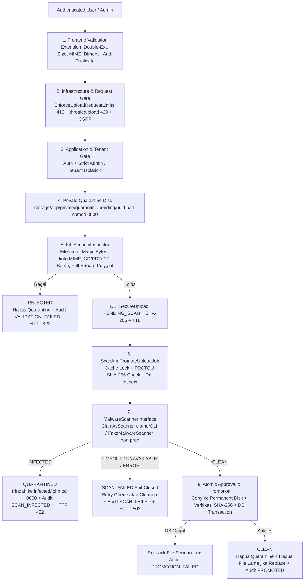

# Secure File Upload Architecture — BanyuWening

Arsitektur **Defense in Depth (10 Lapisan)** untuk seluruh jalur unggahan file di BanyuWening (`landing_media`, `firmware`, dan `tenant_document`).

---

## 1. Arsitektur End-to-End (Diagram Alur)

---

## 2. File Lifecycle State Machine

Seluruh file yang masuk ke pipeline dikelola melalui enum `App\Enums\UploadStatus` dengan transisi eksplisit yang dikunci di `SecureUpload::transitionTo()`:

| Status | Makna | Transisi Diizinkan | Akses Publik / Download |
|---|---|---|---|
| `PENDING_SCAN` | File diterima di karantina privat, lolos inspeksi awal, menunggu pemindaian. | `SCANNING`, `REJECTED`, `SCAN_FAILED` | **DIBLOKIR (403/404)** |
| `SCANNING` | Sedang diproses di bawah `Cache::lock` oleh `ScanAndPromoteUploadJob`. | `CLEAN`, `QUARANTINED`, `REJECTED`, `SCAN_FAILED`, `PENDING_SCAN` | **DIBLOKIR (403/404)** |
| `CLEAN` | Lolos validasi + malware scanner + verifikasi SHA-256; dipromosikan ke permanent storage. | *(Terminal)* | **DIIZINKAN** (sesuai tenant/profil) |
| `REJECTED` | Ditolak oleh `FileSecurityInspector` atau gagal cek integritas TOCTOU. | *(Terminal)* | **DIBLOKIR** (file dihapus) |
| `QUARANTINED` | Terdeteksi malware/EICAR oleh scanner; dikunci di `quarantine/infected/`. | *(Terminal)* | **DIBLOKIR (403)** |
| `SCAN_FAILED` | Scanner timeout, error, atau tidak tersedia (**Fail-Closed**). | `PENDING_SCAN`, `SCANNING` (saat queue retry) | **DIBLOKIR (503 / 403)** |

---

## 3. Strategi Penyimpanan & Isolasi

| Disk Laravel (`config/filesystems.php`) | Root Path | Visibility | Fungsi |
|---|---|---|---|
| `quarantine` | `storage/app/private/quarantine` | Private (`serve: false`) | Penyimpanan sementara `pending/{uuid}.part` (`chmod 0600`) dan `infected/{uuid}.quarantined`. Tidak dapat diakses via HTTP. |
| `private_uploads` | `storage/app/private/uploads` | Private (`serve: false`) | Penyimpanan permanen `tenant_document` per tenant (`tenants/{TENANT_CODE}/{uuid}.{ext}`). Diunduh hanya melalui `SecureUploadController@download` dengan verifikasi tenant + SHA-256 + header `nosniff`. |
| `firmware_private` | `storage/app/private/firmware` | Private (`serve: false`) | Penyimpanan permanen binary OTA `.bin`. Hanya dapat diunduh device jika `is_active = true` dan `scan_status = 'CLEAN'`. |
| `landing_public` | `public/uploads` | Public | Hanya menerima file `landing_media` **setelah** status `CLEAN`. Dilindungi `public/uploads/.htaccess` (`Options -Indexes -ExecCGI`, `php_flag engine off`, blokir ekstensi skrip). |

---

## 4. Integrasi Malware Scanner & Fail-Closed Design

- **Kontrak:** `App\Services\Upload\Contracts\MalwareScannerInterface`
- **Production Adapter (`ClamAvScanner`):**
  - Mendukung mode `daemon` (`clamd` via TCP/Unix socket menggunakan protokol `zINSTREAM`) dan `cli` (`clamdscan --no-summary` / `clamscan --no-summary --infected`), serta mode `auto` (daemon terlebih dahulu, lalu CLI).
  - Menegakkan batas `max_scan_bytes` (50 MB) dan `timeout_seconds` (30 detik).
- **Test Adapter (`FakeMalwareScanner`):**
  - Aktif hanya saat `UPLOAD_SCANNER_DRIVER=fake` (dikonfigurasi di `phpunit.xml`).
  - Memeriksa signature standar `EICAR` dan mendukung simulasi `timeout`, `unavailable`, `error`, `infected`, serta `fail_once_then_clean` untuk uji queue retry.
  - **Hardening Guard:** Menolak berjalan apabila `app()->environment('production')` dan selalu mengembalikan `UNAVAILABLE` (fail-closed).
- **Perilaku Fail-Closed:** Jika scanner mengembalikan `TIMEOUT`, `UNAVAILABLE`, atau `ERROR`, file tidak pernah dipromosikan ke permanent storage maupun `public/uploads/`, `FirmwareRelease` tidak diaktifkan, dan HTTP `503` dikembalikan ke klien.

---

## 5. Tenant Isolation & Security Boundaries

1. **Non-Admin Tenant Binding:** Pengguna non-admin hanya boleh mengunggah ke `tenant_code` miliknya sendiri; upaya menyuplai `tenant_code` tenant lain langsung ditolak `403` (`CROSS_TENANT_UPLOAD_FORBIDDEN`) dan dicatat sebagai `ACCESS_DENIED`.
2. **UUID Route Binding:** Seluruh endpoint `/dashboard/uploads/{upload}` menggunakan `uuid` (bukan sequential integer ID) untuk mencegah enumerasi IDOR.
3. **Strict Admin Gate untuk Sistem:** `uploadLandingMedia` dan seluruh endpoint mutasi OTA admin (`OtaController::authorizeAdmin()`) mewajibkan `$user->isAdmin()` secara ketat.
4. **Audit Trail Bebas Secret:** `SecureUploadAuditService` mencatat event ke tabel `secure_upload_audit_logs` dan channel harian `security_uploads` (`storage/logs/security-uploads.log`) dengan penyaringan eksplisit agar password, token, `APP_KEY`, dan isi file tidak pernah tercatat.
