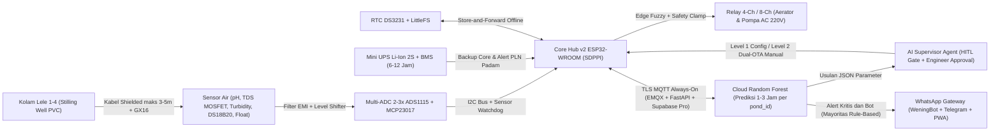

# PITCH DECK FINAL: **BANYUWENING**
### *Smart Aquaculture for a Sustainable Future*
**Dokumen Kanonikal Final (Skor Evaluasi Investor: 89/100 — `Funded: True`)**  
**Putaran:** Pre-Seed Rp600.000.000 (*Post-Money SAFE, Valuation Cap Rp4.000.000.000, Pencairan 3 Tranche Berbasis Milestone*)  
**Status Operasional Saat Ini:** Tahap Lab Prototipe & Desk Research (Protokol Validasi Primer & Pilot 90 Hari Siap Jalan Bulan 1)

---

## SLIDE 1: COVER & INTRODUCTION

### Identitas & Elevator Pitch
**BanyuWening** — *"Smart Aquaculture for a Sustainable Future"*  
Platform **IoT Modular Multi-Kolam & AI Decision Support** yang dirancang khusus untuk UMKM pembesaran ikan lele kolam terpal di Indonesia. Satu **Core Hub v2** memantau hingga **4 kolam berdempetan** secara bersamaan dengan biaya seperlima solusi *enterprise*, mengendalikan aerator/pompa secara otomatis bahkan saat **WiFi mati**, memberi peringatan dini saat **listrik PLN padam**, dan mengirimkan prediksi kualitas air 1–3 jam ke depan langsung ke **WhatsApp** petambak.

### Ringkasan 30 Detik (Executive Snapshot)
- **Masalah Nyata:** Industri lele nasional bernilai bruto **~Rp26,25 triliun/tahun** (1,193 juta ton pada 2025 sementara), tetapi kualitas air buruk memicu lonjakan mortalitas dari **0–10%** menjadi **20–30%** hingga **50–100%** saat anoksia/amonia akut.
- **Solusi Hemat & Tangguh:** Arsitektur **1 Core Hub v2 : 1–4 Modul Kolam v2** (Starter 2K **Rp2.450.000**, Juragan 4K **Rp4.150.000**), **Edge Fuzzy + Store-and-Forward** (*Offline-Plus* Rp0 permanen — *Anti-Bricking*), Cloud Random Forest, dan **WeningBot WhatsApp-First**.
- **Validitas & Disiplin Bisnis:** Prototipe lab awal terverifikasi **Rp1.203.500** (+ongkir Rp200.000 = Rp1.403.500 < batas Rp1,5 juta; COGS murni Rp1.138.500). Tahun-1 terkunci pada **85 Sistem Komersial (220 Kolam)**, **Revenue Rp271,23 juta**, **Kas Akhir M12 +Rp147,205 juta**, dan tata kelola *Single-Book Accounting* pasca-skandal eFishery.
- **Keputusan Pendanaan:** **Rp600.000.000 Pre-Seed** (*Tranche-Based SAFE*, *runway* 18+ bulan).

---

## SLIDE 2: PROBLEM & VALIDASI KUANTITATIF (TIER 1 PROBLEM)

### 1. Skala Komoditas & Masalah Kualitas Air *(Data Terverifikasi KKP, BPS, SNI & Jurnal)*
- **Produksi Pembesaran Lele Nasional (Portal Data KKP):** **1.157.755,37 ton (2024)** $\rightarrow$ **1.193.006,15 ton (2025 sementara)** $\rightarrow$ **1.065.419,23 ton (2026 estimasi awal)**, dengan sentra utama di Jawa Barat, Jawa Tengah, dan Jawa Timur.
- **Basis Pelaku Usaha (BPS & KKP KUSUKA):** Potensi **1,3–1,4 juta Rumah Tangga Perikanan (RTP)** pembudidaya ikan nasional; **~677.500 RTP** terdaftar aktif di sistem KUSUKA KKP.
- **Dampak Kualitas Air terhadap Mortalitas (SNI & Jurnal Akuakultur):**
  - *Air Optimal:* Tingkat kelulusan hidup (**SR 90%–100%**, mortalitas 0%–10%).
  - *Air Buruk (pH <6 atau >8,5, suhu >32–33°C, DO rendah, penumpukan bahan organik):* **SR turun ke 70%–80%** (mortalitas 20%–30%).
  - *Anoksia / Amonia Akut:* Mortalitas mendadak mencapai **50%–100%** dalam hitungan jam (terutama malam/dini hari atau pasca-hujan).

### 2. Simulasi Kerugian Finansial Nyata Petambak
- **Ekonomi Dasar (1 Kolam Terpal, 1.000 ekor, SR 85%, panen 200 g = 170 kg):** Harga jual petambak **Rp20.000–Rp24.000/kg** (basis konservatif **Rp22.000/kg**) $\rightarrow$ Omzet **Rp3.740.000/siklus (3 bulan)**; biaya operasional **~Rp1.600.000** (pakan **Rp11.000–Rp13.000/kg** menyerap **70%–80%** biaya ops) $\rightarrow$ Profit kotor **~Rp2.140.000/siklus**.
- **Risiko Gagal Deteksi pada Klaster 4 Kolam (680–800 kg/siklus):** Penurunan SR ekstra **20%** akibat telat mengantisipasi drop kualitas air menghilangkan panen **136–160 kg = kerugian Rp3,0–Rp3,5 juta per siklus** (**Rp12–Rp14 juta/tahun** dalam 4 siklus).

### 3. Status Kejujuran Data & Protokol Validasi Primer Bulan 1 *(Zero Fake Data)*
- **Transparansi Penuh:** Kami menegaskan bahwa **nol wawancara lapangan maupun uji ketahanan sensor di kolam berlumpur yang diklaim telah selesai**. Status saat ini murni **Tahap Lab Prototipe & Desk Research**.
- **Protokol Eksekusi Terkunci Bulan 1 & Q1 (Anggaran M1 Rp14.000.000 + Uji Lab Q1 Rp4.000.000 = Rp18.000.000):**
  1. **Survei & FGD Primer Seragam (Bulan 1):** **24 responden petambak lele aktif di 2 Pokdakan mitra** untuk memvalidasi *willingness-to-pay* DP 50%, kepatuhan bilas probe mingguan, serta penerimaan biaya ganti probe pH **Rp195.000** per 4–6 bulan.
  2. **Pilot Lapangan 90 Hari (Q1):** Instalasi **4 unit Sistem Pilot v2 non-komersial (Rp7.000.000)** yang diukur silang memakai **2 unit DO Meter Portabel terkalibrasi (Rp5.200.000)** serta **Test Kit Amonia ($NH_3/NH_4^+$), Nitrit ($NO_2^-$), dan buffer ekstra (Rp1.800.000)**—total belanja M1 **Rp14.000.000**—guna menghasilkan label *ground-truth* objektif di lumpur lele.

---

## SLIDE 3: SOLUTION & SHARP UNIQUE VALUE PROPOSITION (UVP)

### 1. Solusi Terpadu: Modular Multi-Kolam + Hybrid Edge-Cloud AI
1. **1 Core Hub v2 Melayani Maksimal 4 Kolam (1 Pemilik):** Menghilangkan pemborosan beli 1 alat per kolam; menggunakan soket kedap air GX16 dan kabel *shielded* **maksimal 3–5 meter** pada klaster kolam berdempetan dalam satu lokasi (**klaim patungan antar-tetangga resmi dihapus**).
2. **Kontrol Otomatis Lokal & Anti-Bricking:** **Edge Fuzzy Logic + Store-and-Forward** (LittleFS + RTC DS3231) otomatis menyalakan aerator/pompa saat parameter melenceng dan menyimpan data lokal ketika WiFi terputus. Jika SaaS dijeda, mode **Offline-Plus (Rp0)** tetap berjalan permanen.
3. **Prediksi Dini & Pendamping WhatsApp:** **Cloud Random Forest** (per `pond_id`) memprediksi risiko 1–3 jam ke depan, dipadukan **AI Agent Supervisor** (*Human-in-the-Loop Gate*) melalui **WeningBot WhatsApp-First**.

### 2. Klarifikasi Jujur Teknis, Daya Listrik & Consumables
- **Pemisahan Tegas — WiFi Mati vs Listrik PLN Padam:**
  - *Saat WiFi Mati:* Edge Fuzzy dan Relay tetap menggerakkan aerator/pompa secara lokal serta mencatat log di LittleFS.
  - *Saat PLN Padam:* **Mini UPS Li-Ion 2S (2×18650 + BMS)** menjaga Core Hub, RTC DS3231, dan pencatatan LittleFS tetap hidup **6–12 jam** (dengan *backlight* LCD mati & *duty-cycling* sensor) serta mengirim peringatan *"Listrik PLN Padam"* via WhatsApp (jika router berdaya). **Dinyatakan jujur:** aerator/pompa AC 220V **tidak berjalan saat PLN padam** tanpa genset atau inverter eksternal.
- **Klasifikasi Probe pH sebagai Consumable:** Garansi elektronik **12 bulan** hanya berlaku untuk **Core Hub v2 & modul kering IP65**. Probe kaca pH (`PH-4502C`) dan elektroda TDS berstatus **Consumable** dengan umur pakai riil **4–6 bulan** di lumpur lele (garansi DOA 30 hari; pengganti resmi **Rp195.000/probe**).
- **Absennya Sensor DO & Amonia di Paket Standar:** Diakui jujur karena harga dan perawatan sensor DO/NH3 industri melampaui daya beli UMKM. Risiko dikompensasi oleh **proxy fitur multivariat** (Suhu, Turbiditas, TDS, pH, laju perubahan, siklus diurnal), **Sensor Health Watchdog**, serta **slot ekspansi I2C/GX16** untuk **Add-on Modul DO Pro**.

---

## SLIDE 4: PRODUCT & DEEP-TECH ARCHITECTURE

### 1. Spesifikasi Hardware v2 Terkoreksi
- **Core Hub v2 (COGS Rp595.000 | Satuan Rp900.000):** *Custom Carrier PCB* dengan **ESP32-WROOM (*pre-certified* SDPPI, menuju sertifikasi perangkat jadi SDPPI/DJID Komdigi)**, **Mini UPS 2S (2×18650 + BMS)**, **2× ADS1115 (8 kanal ADC untuk Starter 2K)** atau **3× ADS1115 (`0x48`–`0x4A`, 12 kanal ADC untuk Juragan 4K)**, **I2C GPIO Expander (`MCP23017`/`PCF8574`)**, **Logic Level Shifter 3.3V$\leftrightarrow$5V**, **RTC DS3231**, **LCD 16x2**, **Box IP65 dengan 4 port chassis GX16** (terisi 2 soket aktif pada Starter 2K; 4 soket penuh pada Juragan 4K), **Relay 4-Ch (Starter 2K: 2 aktuator/kolam)** atau **Relay 8-Ch optocoupler (Juragan 4K + Expansion Kit: 2 aktuator/kolam [aerator + pompa])**, serta **QC Burn-in Test 48 Jam**.
- **Modul Sensor Kolam v2 (COGS Rp535.000 | Satuan Rp800.000):** Probe pH `PH-4502C`, `DS18B20` 1-Wire, sensor **TDS dengan MOSFET power-switch** (mencegah elektrolisis/korosi probe), **Turbidity berpotting epoxy** dalam *stilling well* PVC, *Float Switch*, dan kabel *shielded* + filter EMI RC/ferrite ($\le$3–5 m, terpisah dari jalur AC 220V).

### 2. Ketahanan Lumpur, Keamanan AI & Arsitektur Cloud Always-On
- **Sensor Health Watchdog:** Mendeteksi nilai *flatline/stuck-at-rail* (mis. lensa turbidity jenuh lumut pada minggu ke-4–12), menandai `SATURATED/FAULT`, mengisolasi parameter rusak dari keputusan Fuzzy/RF (*graceful degradation*), dan mengirim notifikasi pembersihan ke WhatsApp.
- **Cold-Start 4-Fase & Biologi Ikan Lele:** Karena ikan lele memiliki organ labirin (*arborescent*) yang membuat perilaku *piping* membiaskan pengamatan mata, model Hari 0–30 memakai **Edge Fuzzy deterministik + Relative Local Anomaly Detection** sementara data pilot 90 hari dikalibrasi dengan **DO Meter & Test Kit Amonia** sebelum *Cohort Model* diaktifkan.
- **Keamanan AI & WiFi Update (Zero Autonomous Push):** Level 1 JSON Fuzzy Config Push hanya berupa **usulan** yang wajib lolos **Human-in-the-Loop (HITL) Engineer Gate** sebelum dikirim ke MQTT, dan dikunci oleh **Hard Safety Bounds & Duty-Cycle Clamp** di ESP32 agar relay tidak pernah menyala terus-menerus. Level 2 Dual-OTA (*auto-rollback* 60 detik) hanya dipicu manual oleh Engineer.
- **Cloud Always-On (Anti *Free-Tier Trap*):** Menggunakan **EMQX/Mosquitto TLS + FastAPI Always-On + Supabase Pro** (menangani ~2,76 juta baris/bulan pada skala 320 kolam tiap 5 menit dengan agregasi 90 hari) dan **Channel Adapter WhatsApp-First**.

### 3. Diagram Arsitektur End-to-End Sistem BanyuWening v2

---

## SLIDE 5: MARKET OPPORTUNITY (TAM, SAM, SOM)

### 1. Analisis Pasar Top-Down Terverifikasi (KKP, BPS & KUSUKA)
| Lapisan Pasar | Basis Populasi & Penyaringan Teknis | Nilai Pasar Tahun-1 *(HW + SaaS)* | Potensi *Recurring* Tahunan |
| :--- | :--- | :---: | :---: |
| **TAM** *(Total Addressable Market)* | **1,3–1,4 juta RTP** pembudidaya ikan nasional *(BPS/KKP; titik tengah 1,35 jt RTP)* | **Rp2,93 – Rp3,15 Triliun** *(titik tengah **Rp3,04 T**, basis Entry Rp2,25 jt/RTP)* | **~Rp810 Miliar/thn** *(SaaS dasar Rp600rb/thn)* |
| **SAM Awal (Air Tawar KUSUKA)** | **~200.000 RTP** lele/nila *(disaring dari **~677.500 RTP terdaftar KUSUKA KKP**)* | *(Filter menengah pra-infrastruktur)* | — |
| **SAM Riil Terkoreksi** *(Layak IoT)* | **40.000 – 60.000 RTP** *(20%–30% lele/nila dengan **$\ge$2 kolam terpal + PLN 220V + sinyal**)* | **Rp122 Miliar – Rp218 Miliar** *(basis Starter Rp3,05 jt s.d. Blended Rp3,64 jt/RTP)* | **~Rp40 – Rp65 Miliar/thn** *(SaaS + ganti probe pH)* |
| **SOM FY1** *(Terkunci CFO/COO)* | **85 Sistem Komersial** (**60 Starter 2K + 25 Juragan 4K** = **220 Kolam**; **0,14%–0,21% SAM**) | **Rp271.230.000 Total Revenue FY1** *(HW Rp250,75 jt + SaaS Rp15,80 jt + Probe Rp4,68 jt)* | **Exit M12: 70 Paid SaaS (182 Kolam)** \| **ARR Rp48,30 Jt/thn** *(MRR Rp4,025 jt)* |

*Konteks Ekonomi Komoditas:* Nilai bruto produksi lele nasional 2025p (`1.193.006,15 ton × Rp22.000/kg`) mencapai **~Rp26,25 triliun/tahun** (sentra Jabar, Jateng, Jatim), bukan merupakan TAM produk teknologi.

### 2. Validasi Bottom-Up Kuartalan FY1 (100% Sinkron CFO & COO)
| Kuartal | Paket Starter 2K | Paket Juragan 4K | Total Sistem Terjual | Kolam Terpasang | Fokus Operasional |
| :--- | :---: | :---: | :---: | :---: | :--- |
| **Q1 (M1–M3)** | 0 | 0 | **0 Komersial** *(4 Pilot)* | *(4 Pilot Uji)* | Survei 24 responden (2 Pokdakan), 4 Pilot 90 hari + DO Meter/Ammonia, PT & SDPPI |
| **Q2 (M4–M6)** | 12 | 3 | **15 Sistem** | **36 Kolam** | Produksi batch awal 5 sistem/bln; penarikan Rolling Buffer Rp50 jt (Tranche 2) |
| **Q3 (M7–M9)** | 28 | 12 | **40 Sistem** | **104 Kolam** | Puncak produksi 12–15 sistem/bln; dukungan kader Pokdakan Jabar/Jateng/Jatim |
| **Q4 (M10–M12)** | 20 | 10 | **30 Sistem** | **80 Kolam** | Pengiriman perdana 24 Probe Consumable; exit **70 Paid SaaS (182 kolam)** |
| **TOTAL FY1** | **60 Sistem** | **25 Sistem** | **85 Sistem** | **220 Kolam** | **Revenue Rp271.230.000** (di luar 4 pilot non-komersial Q1) |

---

## SLIDE 6: MARKET & COMPETITIVE LANDSCAPE

### 1. Matriks 2x2 Positioning Map *(Biaya Investasi vs Kecerdasan & Ketahanan Operasional)*
| Sumbu Y (Kecerdasan & Ketahanan) \ Sumbu X (Biaya Awal) | **Kiri: Terjangkau UMKM (`<Rp4,5 Juta`)** | **Kanan: Biaya Tinggi / Enterprise (`Rp9 Jt – Rp39+ Jt`)** |
| :--- | :--- | :--- |
| **Atas — Tinggi:** *Prediktif AI (1–3 Jam) + Kontrol Relay Multi-Kolam + Offline Fuzzy & Mini UPS* | **KUADRAN WHITE SPACE UMKM: BANYUWENING v2** — Starter 2K **Rp2,45 Jt** / Juragan 4K **Rp4,15 Jt** (~Rp1,04 Jt/kolam); Multi-ADS1115, Relay 4/8-Ch, Mini UPS, WhatsApp-First | **KUADRAN ENTERPRISE AIoT:** **Venambak** (Custom B2B AIoT + Solar untuk tambak udang intensif) & **Banoo IoT** (Rp9,5–14,5 Jt, fokus microbubble oksigenasi) |
| **Bawah — Rendah:** *Pengukuran Manual / Pasif Tanpa Otomasi Aktuator & Tanpa Offline AI* | **KUADRAN ENTRY PASIF:** **Tuya Smart WiFi** (Rp785rb–2,4 Jt; indoor akuarium 1 alat:1 titik, tanpa relay/offline) & **Pen pH/TDS Manual** (Rp70–120rb; buta malam/hujan) | **KUADRAN PORTABEL MAHAL:** **JALA Baruno** (~Rp38.888.888 inc. PPN; akurat DO/ORP/RFID 30 kolam udang, namun celup manual tanpa kontrol aerator) |

### 2. Analisis Blue Ocean (Kerangka ERRC)
- **Eliminate (Hapus):** Biaya sensor DO/amonia mahal di paket standar, ketergantungan wajib internet/cloud agar aerator bekerja, serta skema patungan kabel lintas rumah tetangga.
- **Reduce (Kurangi):** Harga per kolam hingga ~Rp1,04–1,225 juta/kolam lewat 1 Core Hub untuk 2–4 kolam, serta friksi adopsi lewat **WhatsApp-First** (bukan aplikasi kompleks atau Telegram-only).
- **Raise (Tingkatkan):** Proteksi kebocoran/EMI (Box IP65, soket GX16, kabel *shielded*, potting epoxy Turbidity), keamanan AI (*HITL Gate* & *Safety Clamp*), dan akurasi ML khusus lele (*ground-truthing* DO Meter).
- **Create (Ciptakan):** Arsitektur *Offline-Plus* permanen (**Anti-Bricking**), peringatan mati listrik PLN via Mini UPS 2S, penagihan SaaS **per siklus panen 3 bulan**, dan pengakuan jujur penggantian probe pH sebagai *consumable*.

### 3. Tabel Perbandingan Kompetitor Riil
| Parameter | **BanyuWening v2** | **JALA Baruno** | **Banoo (Mycrofish)** | **Venambak** | **Tuya Smart WiFi** | **Alat Manual** |
| :--- | :--- | :--- | :--- | :--- | :--- | :--- |
| **Segmen Utama** | UMKM Lele ($\ge$2 kolam terpal) | Tambak Udang Komersial | Budidaya butuh oksigenasi | Tambak Udang B2B | Akuarium & Hidroponik | Petambak Tradisional |
| **Harga Awal** | **Rp2,45 Jt (2K) / Rp4,15 Jt (4K)** | **~Rp38.888.888** (inc. PPN) | Rp3,5–5,5 Jt (Std) / Rp9,5–14,5 Jt (IoT) | Custom B2B (puluhan juta) | Rp785rb – Rp2,4 Jt | Rp70rb – Rp120rb |
| **Multi-Kolam** | **1 Hub $\rightarrow$ maks. 4 kolam** | 1 alat celup bergantian | Per titik aerasi | Multi-titik custom | 1 alat = 1 wadah | Ukur manual satu-satu |
| **Kontrol Aktuator** | **Ya (Relay 4-Ch / 8-Ch otomatis)** | **Tidak** (monitoring saja) | Ya (Microbubble aerasi) | Ya (Otomasi tambak) | Tidak (umumnya monitor) | Tidak |
| **Tahan WiFi & PLN** | **Edge Fuzzy (WiFi mati) + Mini UPS alert (PLN padam)** | Baterai portabel manual | Bergantung modul | Bergantung paket | Mati total tanpa WiFi/AC | Manual tenaga manusia |
| **Prediksi & Kanal** | **RF 1–3 Jam + WhatsApp-First** | Dashboard Web/App JALA | App/Dashboard Banoo | Platform Web B2B | App Tuya/SmartLife | Catatan kertas |

### 4. Evaluasi Jujur Kelemahan & Unfair Advantage
- **Kelemahan Jujur:** (1) Paket standar belum mengukur DO/Amonia secara langsung; (2) Probe kaca pH harus diganti berkala tiap 4–6 bulan; (3) Belum memiliki data validasi lapangan riil sebelum M1–M3 selesai.
- **Unfair Advantage:** Struktur biaya modular 1:4 terendah dengan proteksi EMI/UPS industri, jaringan *Pokdakan* berbasis **WhatsApp Rule Engine** (>90% nol biaya LLM), model *cohort* lele yang akan dilatih menggunakan *ground-truth* DO Meter & Amonia (mengatasi jebakan organ labirin), serta tata kelola *Anti-Bricking* & *Single-Book* yang membangun kepercayaan pasca-skandal eFishery.

---

## SLIDE 7: BUSINESS MODEL & PRICING ARCHITECTURE

### Model Pendapatan 3 Lapis (Hardware + SaaS Siklus Panen + Consumables & Add-On)
Skema transaksi dirancang mengikuti arus kas panen lele (siklus 3 bulanan) dengan sistem **Pre-Order DP 50% + Pelunasan 50% saat instalasi selesai**:

| Lini Produk / Layanan | Komposisi Teknis Terkunci | Harga Resmi (MSRP) | COGS Batch v2 | Kebijakan Siklus / Garansi |
| :--- | :--- | :---: | :---: | :--- |
| **Core Hub v2 (Satuan)** | ESP32-WROOM, Mini UPS 2S, 2× ADS1115, MCP23017, RTC DS3231, LCD, Box IP65 (4 port GX16), Relay 4-Ch | **Rp900.000** | Rp595.000 | Garansi Elektronik **12 Bulan** |
| **Modul Sensor Kolam v2** | PH-4502C + probe kaca, DS18B20, TDS + MOSFET, Turbidity potting epoxy, Float, kabel *shielded* 3–5m | **Rp800.000** | Rp535.000 | Elektronik kering 12 bln; probe DOA 30 hari |
| **Paket Entry (1H + 1M)** | 1 Core Hub v2 + 1 Modul Sensor Kolam v2 | **Rp1.650.000** | Rp1.130.000 | PO DP 50% + Pelunasan 50% |
| **Paket Starter (2K)** *(60 unit FY1)* | 1 Core Hub v2 + 2 Modul Sensor v2 (2 aktuator/kolam) | **Rp2.450.000** | Rp1.665.000 | PO DP 50% (Rp1,225 jt) + Lunas 50% |
| **Paket Juragan (4K + Exp)** *(25 unit FY1)* | 1 Core Hub v2 + 4 Modul Sensor v2 + **Expansion Kit** (3× ADS1115 12-Ch + **Relay 8-Ch** untuk 2 aktuator/kolam) | **Rp4.150.000** | Rp2.830.000 | PO DP 50% (Rp2,075 jt) + Lunas 50% |
| **SaaS Offline-Plus** | Edge Fuzzy lokal, LCD, alarm lokal tanpa cloud | **Rp0 / siklus** | Rp0 | Aktif permanen (**Anti-Bricking**) |
| **SaaS Smart Guard Starter (1–2K)** | Prediksi RF 1–3 jam, WA AI Agent, *auto-backfill*, ekspor laporan, OTA WiFi | **Rp150.000 / siklus** *(Rp50.000/bln)* | Rp10.000/bln *(Rp30rb/siklus)* | Gratis bln ke-1 onboarding; tagih per 3 bln |
| **SaaS Smart Guard Juragan (3–4K)** | Fitur Smart Guard penuh untuk 3–4 kolam + rekap Pokdakan | **Rp225.000 / siklus** *(Rp75.000/bln)* | Rp15.000/bln *(Rp45rb/siklus)* | Gratis bln ke-1 onboarding; tagih per 3 bln |
| **Consumable Probe Kaca pH** | Probe BNC pH pengganti + sachet buffer pH 4 & 7 | **Rp195.000 / probe** | Rp135.000 | Ganti berkala tiap 4–6 bulan |
| **Jalur Add-On Pro (Ekspansi)** | Slot ekspansi I2C/GX16 siap integrasi **Modul Sensor DO Pro** atau modul relay tambahan *(roadmap Tahun-2/Pro)* | *Priced as Add-On* | — | Untuk segmen intensif / komoditas sensitif O2 |

---

## SLIDE 8: UNIT ECONOMICS & FINANCIAL PROJECTIONS

### 1. Rekonsiliasi BOM Ritel Prototipe vs Batch v2 *(Diskon Sensor Konservatif -22%)*
- **Prototipe Lab Ritel (Single-Kolam):** Total komponen awal **Rp1.203.500** (+ cadangan ongkir Rp200.000 = Rp1.403.500 < batas Rp1,5 juta); COGS terpasang murni tanpa breadboard (Rp15rb) & buffer (Rp50rb) = **Rp1.138.500**.
- **Batch v2 Komersial (Memasukkan Upgrade Teknis Ronde 2 + QC Burn-in 48 Jam):**
  - **Entry (1H + 1M):** COGS **Rp1.130.000** | Harga **Rp1.650.000** | GP **Rp520.000 (31,52%)**.
  - **Starter (1H + 2M):** Baseline v1 Rp1.562.000 + Mini UPS 2S Rp50.000 + 2nd ADS1115 & MCP23017 Rp25.000 + 2× *shielded*/EMI Rp28.000 = **COGS Rp1.665.000** | Harga **Rp2.450.000** | GP **Rp785.000 (32,04%)**.
  - **Juragan (1H + 4M + Exp):** Baseline v1 Rp2.669.000 + Mini UPS 2S Rp50.000 + 4× *shielded*/EMI Rp56.000 + Expansion Kit (3rd ADS1115 + Relay 8-Ch + 2 GX16) Rp55.000 = **COGS Rp2.830.000** | Harga **Rp4.150.000** | GP **Rp1.320.000 (31,81%)**.
  - **Blended Hardware (60S + 25J):** Harga rata-rata **Rp2.950.000** | COGS **Rp2.007.647** | GP **Rp942.353 (31,94%)**.
  - **SaaS Gross Margin:** **80,00%** (Cloud/AI IoT per paid hub hanya **Rp10.000/bln** untuk Starter dan **Rp15.000/bln** untuk Juragan). **Consumable Probe pH GM:** **30,77%** (GP Rp60.000/probe).

### 2. Unit Economics (Churn 10% per Siklus 3-Bulan $\rightarrow$ Lifetime 24 Bulan)
| Metrik | Starter (2K) | Juragan (4K) | **Blended Base Case (60S + 25J)** |
| :--- | :---: | :---: | :---: |
| **Blended CAC** *(Komisi Pokdakan Rp150rb + Demo/Transport Rp100rb + Ads WA/FB Rp50rb)* | Rp300.000 | Rp300.000 | **Rp300.000** |
| **LTV Inti** *(HW GP + SaaS GP 24 bln)* | Rp1.745.000 | Rp2.760.000 | **Rp2.043.529** (**LTV:CAC = 6,81 : 1**) |
| **LTV + Consumables Probe pH** *(3× ganti @ retensi 80%)* | Rp2.033.000 | Rp3.336.000 | **Rp2.416.235** (**LTV:CAC = 8,05 : 1**) |
| **CAC Payback Period** | **0 Bln** *(instan)* / 7,5 bln *(SaaS murni)* | **0 Bln** *(instan)* / 5,0 bln *(SaaS murni)* | **0 Bln** *(instan)* / **6,5 bln** *(SaaS murni)* |

### 3. ROI Petambak 12 Bulan Bersih (Sudah Memasukkan Biaya Ganti Probe pH)
- **Juragan 4 Kolam:** Total biaya Tahun-1 All-In = `Rp4.150.000 (HW) + Rp900.000 (4 siklus SaaS) + Rp780.000 (4 probe @Rp195rb)` = **Rp5.830.000**. Mencegah kerugian SR -20% (`Rp12–14 juta/tahun`, `Rp3,0–3,5 juta/siklus`) $\rightarrow$ **Payback 1,25–1,46 siklus (~3,8–4,4 bulan)** *(atas biaya masuk Rp4,375 jt; atau 1,67–1,94 siklus atas total all-in setahun)*; **Net Benefit +Rp6,17–Rp8,17 juta (ROI 105,8%–140,1%)**.
- **Starter 2 Kolam:** Total biaya Tahun-1 All-In = `Rp2.450.000 (HW) + Rp600.000 (4 siklus SaaS) + Rp390.000 (2 probe @Rp195rb)` = **Rp3.440.000**. Manfaat proporsional 2 kolam (`Rp6–7 juta/tahun`, `Rp1,5–1,75 juta/siklus`) $\rightarrow$ **Payback 1,49–1,73 siklus (~4,5–5,2 bulan)** *(atas biaya masuk Rp2,60 jt; atau 1,97–2,29 siklus atas total all-in setahun)*; **Net Benefit +Rp2,56–Rp3,56 juta (ROI 74,4%–103,5%)**.

### 4. Ringkasan Proyeksi P&L 12 Bulan & Rincian OPEX Rp496.000.000
| Pos Laporan Keuangan FY1 | Jumlah (Rp) | Rincian Komponen Terverifikasi |
| :--- | :---: | :--- |
| **Total Revenue FY1** | **Rp271.230.000** | Hardware Rp250.750.000 (60S + 25J) + SaaS Rp15.800.000 + 24 Probe pH Rp4.680.000 |
| **Total COGS FY1** | **Rp178.025.000** | Hardware Rp170.650.000 + Cloud/AI IoT Terbayar Rp4.135.000 + 24 Probe Rp3.240.000 |
| **Gross Profit FY1 (34,36%)** | **Rp93.205.000** | Margin sehat di tahun pertama dengan diskon sensor konservatif -22% |
| **OPEX: Tim & Teknisi (12 Bln)** | Rp216.000.000 | Kompensasi 5 pendiri (transisi Q1 $\rightarrow$ FT bertahap T1/T2) + 1 teknisi rakit/QC |
| **OPEX: Workshop & R&D PCB** | Rp50.000.000 | Tooling *Custom Carrier PCB*, alat kerja, jig QC, & operasional lab/kantor |
| **OPEX: Validasi Fisik Q1** | Rp18.000.000 | **Rp14 jt di M1** (2 DO Meter Rp5,2 jt + Test Kit Rp1,8 jt + 4 Pilot Rp7 jt) + Rp4 jt uji lab Q1 |
| **OPEX: Fixed Cloud & Bot Freemium** | Rp18.000.000 | **Rp1.500.000/bln** (Fixed Cloud Always-On [VPS, Supabase Pro, EMQX, WA Gateway] Rp1,05 jt/bln + Kuota LLM Freemium 1.000 user Rp450rb/bln) |
| **OPEX: Marketing & Akuisisi** | Rp95.500.000 | Blended CAC 85 sistem (Rp25.500.000) + Aktivasi Pokdakan & funnel 1.000 user WA (Rp70.000.000) |
| **OPEX: Cadangan RMA Core Hub** | Rp8.500.000 | Cadangan garansi elektronik 12 bulan (85 sistem × Rp100.000/sistem) |
| **OPEX: Legal, SDPPI & Audit** | Rp90.000.000 | Pendirian PT, DJKI, **uji/sertifikasi perangkat jadi SDPPI/DJID Komdigi**, & audit eksternal |
| **TOTAL OPEX FY1** | **Rp496.000.000** | *100% rekonsiliasi penuh tanpa pos tersembunyi* |
| **Net Burn FY1** | **-Rp402.795.000** | Ditutup dari dana Pre-Seed Rp600.000.000 |
| **Rolling Component Buffer (M4)** | **-Rp50.000.000** | Ditarik penuh di Tranche 2 untuk ~30 set komponen *long-lead* |
| **Posisi Kas Akhir M12** | **+Rp147.205.000** | *Menopang total runway 18+ bulan menuju putaran Seed* |

---

## SLIDE 9: GO-TO-MARKET (GTM) — AKUISISI 1.000 PENGGUNA PERTAMA

### 1. Mesin Akuisisi WhatsApp-First & Zero LLM Trap
- **Mengapa WhatsApp Gateway:** Petambak lele pedesaan membuka WhatsApp puluhan kali per hari untuk transaksi pakan dan pengepul (friksi jauh lebih rendah dibanding Telegram-only; Telegram & PWA tetap tersedia opsional).
- **Arsitektur Hemat Biaya (>90% Nol Biaya LLM):**
  - *Layer 1 — Rule-Based Engine & FAQ Cache (>90% trafik):* Kalkulator FCR pakan, pengingat jadwal tebar/ganti air, panduan dosis kapur/probiotik, dan template keluhan penyakit berjalan pada **biaya LLM Rp0**.
  - *Layer 2 — Kuota Ketat AI:* Maksimal **3 kueri AI/hari** bagi pengguna Freemium; seluruh biaya Cloud Always-On + WA Gateway + LLM terhitung di **Rp1.500.000/bln (Rp18.000.000/thn)** Tech OPEX.

### 2. Taktik Growth Hack Budget Minim (Marketing OPEX Rp95,5 Juta)
1. **Kemitraan Pokdakan & Penyuluh Perikanan:** Demo langsung di 2 Pokdakan awal (Q1), lalu ekspansi ke sentra lele Jabar, Jateng, dan Jatim lewat skema komisi kader/agen lokal **Rp150.000/sistem terjual** (hanya dibayar saat pelunasan 50% selesai).
2. **Konten Video Lapangan Organik + Iklan Lokal Terarah:** Edukasi kerugian air buruk di grup Facebook/WhatsApp petambak lele dengan anggaran iklan geo-targeted **Rp50.000/sistem** dan biaya demo/transport **Rp100.000/sistem** (**Blended CAC terkunci Rp300.000**).
3. **Skema Pembayaran Anti-Macet Modal Kerja:** Pre-Order **DP 50%** mendanai komponen aktif saat pesanan dikunci, dan **Pelunasan 50%** ditagih saat instalasi & uji sinyal selesai di kolam.

### 3. Corong Konversi Terukur: 1.000 Activated Users $\rightarrow$ 85 Sistem Komersial
| Tahap Funnel GTM (Q1–Q4) | Volume Target | Tingkat Konversi & Mekanisme Pelacakan |
| :--- | :---: | :--- |
| **1. Activated Freemium Users (WeningBot WA)** | **1.000 Petambak** | Registrasi nomor WA + input profil jumlah kolam & lokasi (*UTM/kode Pokdakan*) |
| **2. Qualified ICP Leads** | **~350 Petambak (35%)** | Terfilter memiliki **$\ge$2 kolam terpal + listrik 220V + sinyal** stabil |
| **3. Demo Kolam / Konsultasi PO** | **~150 Prospek (42,9%)** | Mengikuti demo Pokdakan atau simulasi ROI; validasi *DP 50%* |
| **4. Pelanggan Hardware Terlunasi (FY1)** | **85 Sistem (8,5% dari 1.000)** | **60 Starter 2K + 25 Juragan 4K** (Q2: 15, Q3: 40, Q4: 30) |
| **5. Exit Paid SaaS (M12)** | **70 Sistem Berbayar (82,4%)** | Retensi pasca-bulan ke-1 gratis & siklus ke-2 (182 kolam; **MRR Rp4,025 juta**) |

---

## SLIDE 10: PROTOTYPE READINESS, PILOT 90 HARI & EARLY TRACTION TARGETS

### 1. Kesiapan Prototipe Saat Ini & Standar QC Manufaktur
- **Status Lab Terverifikasi:** Prototipe fungsional *single-kolam* telah dirakit di lab (total komponen Rp1.203.500 + ongkir Rp200.000 = Rp1.403.500; COGS murni Rp1.138.500) dan siap bertransisi ke desain **Custom Carrier PCB v2** di Q1–Q2.
- **Standar QC Burn-in 48 Jam Seragam:** Setiap unit Core Hub v2 dan Modul Sensor v2 wajib lulus uji *burn-in* kontinyu **48 jam** di rak QC, kalibrasi 2-titik (buffer pH 4 & 7), uji kedap *potting epoxy* Turbidity & Box IP65, serta **uji beban nyata Mini UPS 2S** (*backlight* LCD mati + *duty-cycling* sensor) untuk memverifikasi ketahanan logging **6–12 jam**.

### 2. SOP Lapangan Wajib di Air Lele Berlumpur
1. **Stilling Well Pipa PVC Pelindung:** Probe pH & turbidity dipasang di dalam pipa PVC berlubang samping & berkasa bawah agar aman dari tubrukan lele, dengan posisi PCB turbidity di atas batas air maksimum (*Float Switch*).
2. **Pemisahan Jalur Kabel:** Kabel *shielded* ($\le$3–5 m) dilarang disatukan dalam satu *conduit* dengan kabel AC 220V pompa/aerator untuk mencegah noise EMI.
3. **Ritual Mingguan & Penggantian Consumable:** Petambak menerima pengingat WhatsApp mingguan (*1-klik konfirmasi*) untuk menyeka lensa turbidity dan membilas probe pH; penggantian probe pH dijadwalkan setiap **4–6 bulan** (Rp195.000).
4. **Log Peristiwa Objektif:** Karena lele memiliki organ labirin (*piping* alami), konfirmasi lapangan diganti menjadi log peristiwa konkret (ikan mati/mengapung, bau menyengat, pakan tersisa, hujan/ganti air) yang dikalibrasi dengan DO Meter saat pilot.

### 3. Target Pilot 90 Hari (Q1) & Metrik Traksi Q1–Q4
- **Gate Pilot Q1 (M1–M3):**
  - Berita acara bermaterai/tanda tangan dari **24 responden survei (2 Pokdakan)** + dokumentasi foto & log digital **4 Unit Pilot v2 selama 90 hari**.
  - Terbentuknya dataset *ground-truth* dari **2 DO Meter Portabel + Test Kit Amonia/Nitrit** (akurasi *alert* anomali air $\ge$80% sebelum kejadian mortalitas akut) dan bukti ketahanan *Sensor Health Watchdog* di kolam berlumpur.
- **Target Traksi Komersial (Q2–Q4):** **15 sistem (Q2)** $\rightarrow$ **kumulatif 55 sistem (Q3)** $\rightarrow$ **85 sistem / 220 kolam (Q4)**; **1.000 user WeningBot**; retensi SaaS siklus panen **$\ge$75%** (exit M12 **70 Paid SaaS**); **0 insiden *bricking*** maupun *runaway relay*; dan deviasi aktual COGS/CAC $\le \pm 10\%$.

---

## SLIDE 11: FOUNDING TEAM & CORPORATE GOVERNANCE

### 1. Tim Pendiri, Komitmen Waktu & Struktur Vesting *(Cap Table Pre-Dilution)*
Seluruh tim saat ini berada dalam fase transisi lab/akademik (25–30 jam/minggu) dan terikat **kontrak kerja serta konversi Full-Time bertahap** sebagai *Condition Precedent* (CP) pendanaan *(identitas resmi, CV, dan background check 5 pendiri dilampirkan saat closing Tranche 1)*:

| Peran & Placeholder Anggota | Tanggung Jawab Utama | Komitmen Waktu | Ekuitas Awal* |
| :--- | :--- | :--- | :---: |
| **CEO** `[Nama Lengkap Pendiri 1 — Strategi/Agri]` | Strategi bisnis, kemitraan Pokdakan, tata kelola & investor | **Full-Time (40+ jam/mg)** saat **Tranche 1** cair | **20%** |
| **CTO** `[Nama Lengkap Pendiri 2 — Embedded/AI]` | Firmware ESP32, Custom PCB v2, Cloud Always-On, ML & AI Safety | **Full-Time (40+ jam/mg)** saat **Tranche 1** cair | **20%** |
| **COO** `[Nama Lengkap Pendiri 3 — Manufaktur/Ops]` | Rantai pasok BOM v2, QC Burn-in 48 jam, SOP Pilot 90 hari & RMA | **Full-Time (40+ jam/mg)** saat **Tranche 1** cair | **17%** |
| **CFO** `[Nama Lengkap Pendiri 4 — Akuntansi/Keuangan]` | *Single-Book Accounting*, unit economics, laporan kas & audit | Part-Time Q1 $\rightarrow$ **Full-Time** di **Tranche 2 (M4)** | **17%** |
| **CMO** `[Nama Lengkap Pendiri 5 — Growth/Sales]` | Funnel 1.000 user WA, kader Pokdakan, validasi 24 responden & PO | Part-Time Q1 $\rightarrow$ **Full-Time** di **Tranche 2 (M4)** | **16%** |

*\*Sisa **10% ESOP Pool** dikunci sebelum konversi SAFE. Seluruh saham pendiri (90%) tunduk pada **4-Year Vesting dengan 1-Year Cliff**, klausul Good/Bad Leaver, dan pengalihan hak kekayaan intelektual (**IP Assignment**) penuh ke **PT BanyuWening**.*

### 2. Empat Pilar Tata Kelola Anti-Fraud Pasca-Skandal eFishery (2024–2026)
1. **Single-Book Accounting & Zero Channel Stuffing:** Hanya satu pembukuan diaudit; **DP 50% maupun pre-order tidak diakui sebagai revenue**. Pendapatan hardware hanya dicatat setelah instalasi selesai di kolam, lulus uji, dan pelunasan 50% masuk ke rekening koran perusahaan.
2. **Anti-Bricking & Kedaulatan Petambak:** Perangkat keras adalah milik penuh petambak; jika langganan SaaS tidak diperpanjang, fungsi inti Edge Fuzzy tetap bekerja gratis selamanya (*Offline-Plus*).
3. **Zero-Hype Field Verification:** Tidak ada data testimoni atau metrik traksi fiktif; laporan bulanan kepada investor wajib menyertakan mutasi rekening koran, jumlah unit aktif di server EMQX/Supabase, metrik churn SaaS, serta hak *Board Observer Seat*.
4. **AI & Firmware Safety Gate:** Nol pembaruan otonom ke kolam; seluruh *JSON Fuzzy Config* dan *Dual-OTA rollback* wajib mendapat persetujuan manual Engineer dengan batasan keras (*Hard Safety Bounds*).

---

## SLIDE 12: THE ASK, USE OF FUNDS & 12-MONTH ROADMAP

### 1. Kebutuhan Pendanaan & Struktur Instrumen
- **Pre-Seed Ask:** **Rp600.000.000** menggunakan instrumen **Post-Money SAFE** (*Valuation Cap* **Rp4.000.000.000** — implikasi kepemilikan ~15% saat konversi Seed — atau *Diskon Konversi* **20%**, dipilih harga per saham yang lebih menguntungkan investor).
- **Kondisi Prasyarat (CP) Sebelum Closing Tranche 1:** (a) Kelengkapan identitas resmi, CV, *background check*, & kontrak kerja/vesting 5 pendiri; (b) Lampiran rincian OPEX Rp496 juta & konfirmasi penawaran Balai Uji SDPPI/DJID; (c) Penguncian akhir skema PCB Mini UPS 2S & soket GX16; (d) Akta pendirian PT & rekening bank perusahaan.

### 2. Tabel Alokasi Dana Pre-Seed (TEPAT 100%)
| Pos Penggunaan Dana | Persentase | Nominal (Rp) | Rincian Alokasi Operasional (Menopang Runway 18+ Bulan) |
| :--- | :---: | :---: | :--- |
| **Operations, Hardware & Working Capital** | **35%** | **Rp210.000.000** | *Rolling Component Buffer* **Rp50 jt** (ditarik di Tranche 2 M4), workshop/jig QC, cadangan RMA Rp8,5 jt, gaji/ops produksi & instalasi |
| **Technology, R&D, Cloud & Validasi** | **30%** | **Rp180.000.000** | Validasi fisik Q1 **Rp18 jt** (Rp14 jt di M1 + Rp4 jt lab), *Custom Carrier PCB*, Cloud Always-On & WeningBot **Rp18 jt/thn**, gaji/kompensasi tim Tech |
| **Marketing, GTM & Akuisisi 1.000 User** | **20%** | **Rp120.000.000** | Marketing OPEX FY1 **Rp95,5 jt** (CAC 85 sistem @Rp300rb = Rp25,5 jt + aktivasi Pokdakan & WA funnel Rp70 jt) + cadangan ekspansi M13+ |
| **Legal, PT, DJKI, SDPPI/DJID & Audit** | **15%** | **Rp90.000.000** | Pendirian badan hukum PT, pendaftaran merek/paten sederhana DJKI, **uji/sertifikasi perangkat jadi SDPPI/DJID Komdigi**, & audit eksternal |
| **TOTAL PRE-SEED ASK** | **100%** | **Rp600.000.000** | **100% Terikat Single-Book Accounting & Milestone Gate** |

### 3. Pencairan 3 Tranche & Roadmap Terukur 12 Bulan (Q1–Q4)
| Tranche & Periode | Dana Cair | Milestone Gate Wajib & Target Eksekusi Terukur |
| :--- | :---: | :--- |
| **Tranche 1 — Q1 (M1–M3)** | **Rp200.000.000** *(33,33%)* | **CP Closing terpenuhi**; CEO/CTO/COO **Full-Time**. Eksekusi: PT & pengajuan DJKI/SDPPI perangkat jadi, belanja validasi M1 **Rp14 jt** (2 DO Meter + Test Kit + 4 Pilot v2) + uji lab **Rp4 jt**, **survei 24 responden (2 Pokdakan)**, dan mulai **Pilot 90 Hari** *(Rolling Buffer Rp50 jt ditahan ke T2 agar likuiditas Q1 lega)*. |
| **Tranche 2 — Q2 (M4–M6)** | **Rp250.000.000** *(41,67%)* | **Gate Wajib:** Berita acara Pilot 90 hari & 24 responden (data DO/Amonia, uji lumpur, & uji daya Mini UPS 2S 6–12 jam), kepastian kepatuhan **SDPPI/DJID aman**, serta konversi **CFO & CMO Full-Time**. Eksekusi: Penarikan **Rolling Buffer Rp50 jt**, peluncuran komersial **15 sistem (36 kolam)**, aktivasi **500 user WeningBot WA**. |
| **Tranche 3 — Q3–Q4 (M7–M12)** | **Rp150.000.000** *(25,00%)* | **Gate Wajib (M8):** Minimal **40 sistem terpasang & terlunasi 100%** (rekening koran + berita acara), retensi SaaS panen **$\ge$75%**, nol insiden *bricking/runaway relay*, deviasi COGS/CAC $\le \pm 10\%$. Eksekusi: Tuntaskan **Q3 (40 sistem) & Q4 (30 sistem)** = **85 sistem / 220 kolam**, **1.000 user WA**, **70 Paid SaaS (MRR Rp4,025 jt)**, **Kas Akhir M12 +Rp147.205.000** (*runway* 18+ bln). |

---

## LAMPIRAN A: SPEAKER NOTES (SLIDE 1–12) & 7 TANYA-JAWAB KRITIS INVESTOR/DOSEN

### Bagian 1: Speaker Notes (Naskah Presentasi Singkat Slide 1–12)
- **Slide 1:** *"Selamat pagi Bapak/Ibu Investor dan Dewan Penguji. Kami adalah BanyuWening. Kami membangun IoT modular multi-kolam dengan AI yang tetap menjaga kolam lele petambak saat WiFi mati, memberi peringatan cepat saat listrik PLN padam lewat Mini UPS, dan dapat diakses langsung lewat WhatsApp—tanpa mengunci perangkat saat langganan dijeda."*
- **Slide 2:** *"Indonesia memproduksi lebih dari 1,15 juta ton lele per tahun, namun kualitas air buruk memangkas survival rate 20 hingga 30 persen dan merugikan klaster 4 kolam Rp3 hingga Rp3,5 juta per siklus panen. Kami jujur: saat ini kami berada di tahap lab prototipe dan belum mengklaim wawancara selesai; Bulan 1 kami langsung menjalankan protokol 24 responden di 2 Pokdakan dan 4 pilot 90 hari bermodal DO Meter serta test kit amonia."*
- **Slide 3:** *"Solusi kami mengganti sistem mahal satu alat satu kolam menjadi satu Core Hub untuk maksimal empat kolam milik satu petambak dengan kabel shielded maksimal 3 sampai 5 meter. Kami transparan: Mini UPS hanya menyokong Core Hub dan mengirim alarm padam PLN 6–12 jam—bukan menggerakkan aerator AC 220V—dan probe kaca pH kami pisahkan sebagai consumable Rp195 ribu tiap 4–6 bulan di luar garansi hub 12 bulan."*
- **Slide 4:** *"Dari sisi rekayasa, setiap Core Hub v2 memakai hingga tiga chip ADS1115 16-bit, expander MCP23017, MOSFET switch pencegah korosi TDS, dan Sensor Health Watchdog yang otomatis mengisolasi sensor turbidity jika tertutup lumut. AI kami tidak pernah melakukan perubahan otonom ke lapangan; setiap pembaruan konfigurasi wajib melewati persetujuan Engineer serta safety clamp keras pada firmware ESP32."*
- **Slide 5:** *"Dari 677.500 pembudidaya terdaftar KUSUKA KKP, kami menyaring secara konservatif menjadi 40.000 hingga 60.000 rumah tangga siap-IoT yang punya minimal dua kolam terpal, listrik 220V, dan sinyal. Target Tahun-1 kami terkunci realistis di 85 sistem atau 220 kolam terpasang—hanya 0,14 sampai 0,21 persen dari SAM—dengan revenue Rp271,23 juta."*
- **Slide 6:** *"Di peta kompetisi, produk di atas Rp9 juta hingga Rp38 juta tidak terjangkau petambak lele, sedangkan alat Tuya di bawah Rp2,4 juta hanya untuk satu wadah indoor tanpa kontrol relay dan tanpa mode offline. BanyuWening mengisi white space UMKM multi-kolam yang otomatis, tahan offline, dan terhubung ke WhatsApp."*
- **Slide 7:** *"Kami menjual Starter 2-kolam Rp2,45 juta dan Juragan 4-kolam Rp4,15 juta dengan skema pre-order DP 50 persen plus pelunasan 50 persen saat instalasi selesai. SaaS ditagih per siklus panen 3 bulanan—Rp150 ribu untuk Starter dan Rp225 ribu untuk Juragan—sehingga cocok dengan arus kas panen petambak."*
- **Slide 8:** *"Dengan diskon komponen konservatif 22 persen plus seluruh upgrade keamanan, margin kotor hardware kami berada di 31,94 persen dan SaaS 80 persen. Blended CAC Rp300 ribu langsung tertutup di bulan ke-nol dari gross profit hardware, menghasilkan LTV:CAC 6,81 banding 1. Bagi petambak, meski sudah menghitung penggantian probe pH tiap 6 bulan, ROI bersih mereka tetap di atas 74 hingga 140 persen dalam setahun."*
- **Slide 9:** *"Kami tidak membakar uang iklan. Kami mengakuisisi 1.000 petambak pertama lewat WeningBot di WhatsApp—di mana lebih dari 90 persen percakapan dilayani rule-based engine tanpa biaya LLM—lalu mengonversi 8,5 persen di antaranya melalui demo Pokdakan berinsentif komisi Rp150 ribu per sistem terlunasi."*
- **Slide 10:** *"Sebelum menjual satu unit komersial pun di Q2, seluruh perangkat wajib lolos burn-in test 48 jam dan diuji langsung di kolam lele berlumpur selama 90 hari di Q1. SOP kami mewajibkan pipa pelindung PVC dan bilas mingguan yang diingatkan via WhatsApp."*
- **Slide 11:** *"Belajar dari kasus eFishery, kami mengunci empat pilar tata kelola: satu buku pembukuan tanpa mengakui DP sebagai omzet, jaminan anti-bricking, audit lapangan berbasis bukti DO meter, serta vesting 4 tahun dengan cliff 1 tahun bagi kelima pendiri."*
- **Slide 12:** *"Kami mengajukan Pre-Seed Rp600 juta lewat Post-Money SAFE bervaluasi cap Rp4 miliar yang dicairkan bertahap dalam 3 tranche. Dengan OPEX terkendali Rp496 juta termasuk legal/SDPPI Rp90 juta dan buffer komponen Rp50 juta di Tranche 2, kami mengakhiri Bulan 12 dengan kas positif Rp147,205 juta dan runway di atas 18 bulan."*

### Bagian 2: 7 Tanya-Jawab Kritis Investor & Dosen Penguji
1. **Tanya:** *Mengapa tidak menyertakan sensor DO dan Amonia di paket Rp2,45 juta, dan bagaimana mengatasi fakta biologis bahwa lele punya organ labirin (*piping*) yang sering menipu mata petambak?*  
   **Jawab:** Sensor DO optik/galvanik industri beserta probe amonia ($NH_3$) menambah biaya >Rp2–4 juta dan menuntut perawatan membran rumit yang tidak masuk akal bagi UMKM lele. Untuk menjaga keterjangkauan, kami memakai *proxy* multivariat (suhu, turbiditas, TDS, pH, siklus diurnal) dengan **Sensor Health Watchdog** serta menyiapkan slot ekspansi I2C/GX16 untuk modul DO Pro. Khusus bias *piping* akibat organ labirin lele, selama Pilot 90 Hari di Q1 kami tidak melatih ML dari tebakan mata petambak, melainkan langsung memakai **2 DO Meter Portabel & Test Kit Amonia/Nitrit** sebagai *ground-truth*, serta mengubah tombol feedback WA menjadi log peristiwa konkret (ikan mati, bau busuk, pakan sisa).

2. **Tanya:** *Jika listrik PLN padam jam 2 pagi, apakah BanyuWening benar-benar menyelamatkan lele kalau aerator AC 220V tetap mati?*  
   **Jawab:** Kami menyatakan secara jujur bahwa Mini UPS Li-Ion 2S (2×18650 + BMS) **tidak mampu menggerakkan aerator AC 220V**; peran kritisnya adalah mencegah *blind blackout* selama **6–12 jam** agar Core Hub tetap mencatat data di LittleFS dan langsung menembakkan peringatan *"Listrik PLN Padam"* ke WhatsApp petambak (selama modem berdaya) atau membunyikan alarm lokal, sehingga petambak segera menyalakan genset/inverter atau melakukan pergantian air darurat sebelum terjadi anoksia massal.

3. **Tanya:** *Bagaimana memastikan probe kaca pH murah tidak menghancurkan margin garansi 12 bulan seperti masalah banyak startup IoT air?*  
   **Jawab:** Kami memisahkan secara tegas antara **garansi elektronik Core Hub 12 bulan** (dilindungi Box IP65 & cadangan RMA Rp100rb/sistem = Rp8,5 juta di OPEX) dengan **probe kaca pH yang ditetapkan sebagai *consumable*** (umur pakai riil 4–6 bulan di air lele berlumpur, garansi DOA 30 hari). Petambak membeli probe pengganti secara transparan seharga **Rp195.000** (COGS Rp135rb, margin 30,77%), dan biaya ganti probe ini sudah kami masukkan penuh ke simulasi ROI Tahun-1 petambak yang masih menghasilkan keuntungan bersih +74% hingga +140%.

4. **Tanya:** *Apa jaminan bahwa BanyuWening tidak mengulang praktik pembukuan ganda, channel stuffing, atau pemaksaan kunci alat seperti skandal eFishery?*  
   **Jawab:** Tata kelola kami mengunci **Single-Book Accounting**: uang muka DP 50% dicatat sebagai liabilitas/uang muka pelanggan, dan pendapatan baru diakui saat instalasi selesai, lolos verifikasi foto/server, serta pelunasan 50% masuk ke rekening koran. Selain itu, kebijakan **Anti-Bricking** memastikan mode *Offline-Plus* tetap menyala Rp0 jika SaaS dijeda, dan investor memiliki **Board Observer Seat** dengan laporan mutasi koran serta jumlah node aktif server setiap bulan.

5. **Tanya:** *Bukankah 1.000 user bot Freemium dan 320 kolam tiap 5 menit akan membuat tagihan cloud & AI meledak dan terjebak di free-tier Render/Supabase?*  
   **Jawab:** Benar—karena itu kami menolak *free-tier* untuk produksi dan menganggarkan arsitektur **Always-On** (EMQX/Mosquitto TLS + FastAPI Always-On + Supabase Pro + agregasi data 90 hari). Biaya variabel Cloud IoT per sistem berbayar (Rp10rb–15rb/bln) masuk langsung ke COGS (GM SaaS 80%), sementara **Fixed Cloud Always-On + WA Gateway + WeningBot Freemium 1.000 user** dianggarkan eksplisit **Rp1.500.000/bulan (Rp18 juta/tahun)** di Tech OPEX—dijaga ketat oleh *Rule-Based Engine* (>90% trafik = Rp0 LLM) serta batas 3 kueri AI/hari.

6. **Tanya:** *Status saat ini belum punya wawancara lapangan yang selesai dan produk memakai radio WiFi 2,4 GHz. Apa mitigasi risiko regulasi SDPPI/DJID dan kegagalan uji lapangan?*  
   **Jawab:** Untuk regulasi, kami memakai modul ESP32-WROOM *pre-certified* sekaligus menaikkan anggaran Legal/Compliance menjadi **Rp90.000.000 (15%)** guna menutup sertifikasi perangkat jadi **SDPPI/DJID Komdigi**, pendirian PT, dan DJKI sebelum pengiriman komersial Q2. Untuk risiko uji lapangan, pendanaan dicairkan bertahap: Tranche 1 (Rp200 jt) difokuskan hanya pada **24 responden survei** dan **4 Pilot 90 Hari** (Rp14 jt di M1 + Rp4 jt uji lab); dana produksi besar (Tranche 2 Rp250 jt termasuk Rolling Buffer Rp50 jt) **tidak akan cair** jika berita acara uji lumpur, DO ground-truth, uji daya Mini UPS 2S, dan status SDPPI belum terbukti di akhir Q1.

7. **Tanya:** *Bagaimana jika realisasi penjualan Tahun-1 lebih lambat dari 85 sistem atau churn SaaS meningkat; apakah kas perusahaan tetap aman?*  
   **Jawab:** Dengan skema **PO DP 50% + Pelunasan 50%** dan pembatasan **Rolling Buffer hanya Rp50 juta** di Tranche 2 (bukan menimbun stok barang jadi Rp120 juta), modal kerja kami tidak terjebak di gudang saat penjualan melambat. Ditambah pencairan berbasis *tranche*, proyeksi **Kas Akhir M12 sebesar +Rp147.205.000** masih menyisakan bantalan likuiditas *runway* 18+ bulan sehingga kami dapat menyesuaikan laju perekrutan maupun produksi di Q3–Q4 tanpa risiko gagal bayar.

---

## Lampiran B: Log Simulasi & Iterasi Multi-Agent (Founding Team vs Investor)

- **Total Ronde Simulasi**: 2 Ronde
- **Status Akhir Pendanaan**: **DISETUJUI (FUNDED)**
- **Skor Akhir Investor**: **89/100**

### Ronde 1 — Skor: 75/100 (REVISI)
- **Sub-skor Rubrik**: Problem `78` | Solusi & UVP `79` | Kompetisi `80` | Model Bisnis & Unit Econ `66` | GTM 1.000 User `72` | Ask, Roadmap & Governance `74`
- **Evaluasi Investor**: DITOLAK SEMENTARA / HOLD ON ROUND 1 (BELUM LAYAK DIDANAI). Secara fondasi teknis dan etika tata kelola pasca-eFishery, tim BanyuWening menunjukkan integritas data yang sangat baik—tidak memalsukan wawancara petambak, jujur mengakui absennya sensor DO/Amonia dengan mitigasi proxy Random Forest, serta merancang guardrails anti-bricking dan telemetry-backed reporting yang solid. Namun sebagai Managing Partner VC, kami tidak dapat menyetujui pencairan Rp600 juta pada Ronde 1 karena terdapat lima dealbreaker kritis: (1) pertentangan tajam angka penjualan, tarif SaaS, skema modal kerja, dan COGS batch antara CEO, CTO, COO, CMO, dan CFO; (2) asumsi COGS OEM CFO terlalu optimistis (-40% harga sensor pada volume 100–400 unit) dan mengabaikan biaya API LLM 1.000 user Freemium serta bom waktu klaim garansi 12 bulan untuk probe pH murah; (3) inkonsistensi kanal ADC/Relay dan jarak kabel analog pada skema multi-kolam; (4) tingginya friksi Telegram vs WhatsApp pada GTM 1.000 petambak; serta (5) nihilnya data validasi primer dan uji fisik probe di air lele berlumpur. Tim wajib menyelaraskan satu Single Source of Truth finansial-operasional dan memperbaiki celah teknis-GTM sebelum evaluasi ulang Ronde 2.
- **Dealbreakers**:
  - 1. KETIDAKCOCOKAN TARGET VOLUME & REVENUE ANTAR C-LEVEL: CFO memproyeksikan penjualan Tahun-1 sebesar 160 paket (320 kolam, Revenue Rp353,74 juta), sedangkan COO hanya memproyeksikan kapasitas/instalasi 75–100 sistem (~200–300 kolam) di Q4 dan CMO memproyeksikan SOM Tahun-1 hanya 50–100 RTP berbayar (Rp100–220 juta). Jika realisasi mengikuti target COO/CMO (~85 unit), gross profit anjlok dan kas akhir tahun terancam defisit.
  - 2. KONFLIK SKEMA MODAL KERJA & CAC (CMO vs CFO): CMO mengklaim GTM "Rp0 Ad-Spend" dengan skema Pre-Order DP 50% ("Zero Working-Capital Trap"), namun CFO justru menganggarkan Rp120 juta biaya Marketing (termasuk Rp120rb/unit iklan digital dalam Blended CAC Rp400rb) sekaligus mengunci Rp120 juta (20% dana VC) untuk buffer stok inventory (~94 paket tertahan di M12).
  - 3. KONFLIK STRUKTUR HARGA, COGS BATCH, & GARANSI PROBE 12 BULAN: CMO menghitung SaaS flat Rp50rb/bln/RTP (Rp600rb/thn) dan modul Rp600rb; CFO menagih Rp35rb/kolam/bln (1–2 kolam) atau Rp30rb/kolam/bln (4 kolam = Rp120rb/bln atau Rp1,44 juta/thn — 2,4× lipat hitungan ROI petambak CMO!) dan modul Rp650rb. Selain itu, COGS Batch 4-kolam tidak sinkron: COO ~Rp2.669.000 (diskon sensor -22% konservatif + ekspansi multi-kolam), CMO ~Rp2.180.000 (tanpa biaya rakit/QC), sedangkan CFO Rp2.125.000 (memangkas harga probe pH -40,3% dan turbidity -42,5% di volume kecil 100–400 unit). Garansi hardware 12 bulan juga berisiko jebol karena probe kaca pH murah di air lele umumnya drift/rusak dalam 3–6 bulan sementara RMA CFO hanya Rp100rb/paket.
  - 4. CELAH TEKNIS MULTI-KOLAM, DAYA/LISTRIK, & SATURASI SENSOR: (a) 1 chip ADS1115 hanya memiliki 4 kanal analog, padahal 4 kolam × 3 sensor analog (pH, TDS, Turbidity) membutuhkan 12 kanal (3 ADS1115 + GPIO Expander PCF8574/MCP23017) yang belum dihitung di BOM CFO/CMO; (b) Relay 4-Ch hanya cukup untuk 1 aktuator/kolam (tidak cukup jika 4 kolam butuh aerator + pompa sekaligus); (c) Klaim penarikan kabel antar kolam tetangga rentan degradasi sinyal analog & noise EMI dari pompa AC; (d) Tidak ada proteksi UPS/baterai untuk Core Hub saat PLN padam (offline mode saat ini hanya tahan putus WiFi, bukan mati lampu).
  - 5. ZERO VALIDASI LAPANGAN, RISIKO COLD-START ML, & BIAYA TERSEMBUNYI FREEMIUM: Belum ada uji ketahanan sensor di kolam lele berlumpur maupun hasil wawancara validasi primer (bahkan target sampel Pokdakan Bulan-1 tidak sinkron: CEO 15–30, COO 15–25, CMO 10–15). Selain itu, (a) strategi cold-start Random Forest belum menganggarkan DO meter portabel & test kit Amonia untuk ground-truthing (terlebih lele memiliki organ labirin pernapasan udara sehingga perilaku piping membiaskan feedback Ya/Tidak); (b) biaya API LLM & server untuk 1.000 user Telegram Freemium Bot = Rp0 di P&L CFO; (c) tingginya friksi adopsi Telegram di kalangan petambak yang mayoritas memakai WhatsApp; dan (d) porsi Legal Rp60 juta terlalu sempit jika harus menutup sertifikasi SDPPI/DJID Komdigi, pendirian PT, DJKI, dan audit 12 bulan.
- **Feedback per Peran**:
  - **CEO**: 1. Apresiasi tinggi atas penetapan prinsip Zero-Hype, integritas data pasca-eFishery, penolakan terhadap angka wawancara fiktif, serta arsitektur tata kelola 4 pilar (termasuk anti-bricking dan single-book accounting). Narasi masalah dengan data KKP, BPS, SNI, dan simulasi 4 kolam sudah kuat dan audit-ready.
2. Namun sebagai CEO, Anda gagal menjalankan fungsi harmonisasi "Aturan Koherensi" yang Anda tulis sendiri di bagian B: antar-slide tim Anda masih bertabrakan hebat pada jumlah sampel validasi Bulan-1 (Anda tulis 15–30 petambak, COO 15–25, CMO 10–15), harga paket komersial (Slide 3 Anda tidak menyebut harga jual komersial & SaaS sehingga CMO dan CFO menjual skema tarif berbeda 2,4× lipat), serta target volume Tahun-1 (CMO 50–100 RTP, COO 75–100 sistem, CFO 160 paket).
3. Di Ronde revisi, CEO wajib memimpin penyusunan "Single Canonical Operating Plan" yang mengikat seluruh C-level pada satu set angka resmi (harga jual, struktur SaaS per kolam vs per siklus panen, COGS batch konservatif, volume Tahun-1, dan alokasi runway).
4. Lengkapi profil Tim Pendiri (Slide 11) dengan komitmen waktu (full-time vs mahasiswa/part-time), pembagian ekuitas/vesting dasar, serta tunjukkan struktur pencairan dana bertahap (tranche-based) agar selaras dengan standar investasi Pre-Seed pasca-eFishery.
5. Perjelas perbedaan klaim "tahan saat WiFi mati" vs "saat listrik PLN padam" di Slide 1 dan 3 agar tidak terjadi overclaim yang merusak kredibilitas tim saat uji lapangan.
  - **CTO**: 1. Arsitektur sistem 4-lapisan Anda sangat kuat secara konseptual: ADS1115 16-bit + Level Shifter 3.3V<->5V mengatasi kelemahan ADC ESP32, MOSFET power-switch pada TDS mencegah crosstalk arus di kolam yang sama, LittleFS + RTC DS3231 menjaga integritas store-and-forward saat offline, serta guardrail Champion-vs-Challenger dan Dual-Partition OTA 60s rollback menunjukkan kematangan rekayasa.
2. BUG ARSITEKTUR MULTI-KOLAM (KANAL ADC & RELAY): Satu chip ADS1115 hanya memiliki 4 kanal analog, sementara 1 kolam memakai 3 sensor analog (pH, TDS, Turbidity). Artinya untuk 4 kolam diperlukan 3 chip ADS1115 (I2C 0x48–0x4A) atau analog multiplexer plus I2C GPIO Expander (PCF8574/MCP23017). Selain itu, Relay 4-Channel hanya cukup untuk 4 aktuator (1 aerator per kolam pada paket 4-kolam), tidak cukup jika setiap kolam butuh kontrol aerator DAN pompa kuras/isi secara terpisah. Spesifikasi batasan ini harus ditulis eksplisit dan disinkronkan ke BOM CFO.
3. RISIKO FISIK SENSOR DI LUMPUR LELE & PANJANG KABEL: (a) Probe kaca PH-4502C dan sensor turbidity optik murah di air lele kaya lendir/TSS berisiko mengalami biofouling drift cepat dan saturasi sinyal (nilai turbidity mentok maksimal di minggu ke-4 s.d. ke-12 sehingga slope dTurb/dt menjadi flat); (b) Kabel sensor analog mV/5V (pH & turbidity) jika ditarik >5 meter antar-kolam mudah terkena voltage drop dan interferensi EMI dari aerator AC 220V. Tetapkan batas panjang kabel maksimum (misal <=3–5 meter klaster kolam terpal berdempetan) atau tambah pengondisi sinyal/shielded cable.
4. RISIKO COLD-START, BIOLOGI LELE, & AI SELF-UPDATE: (a) "Lab-Calibrated Prior Model" dari simulasi bak lab berisiko mengalami covariate shift parah terhadap kolam budidaya riil; (b) Ikan lele memiliki organ pernapasan tambahan (arborescent) untuk menghirup udara langsung, sehingga gejala DO rendah di kolam lele berbeda dengan ikan nila/udang dan membuat tombol feedback Ya/Tidak dari petambak berisiko noisy—wajib divalidasi dengan DO meter & test kit Amonia selama pilot 90 hari; (c) Pada Level 1 WiFi Update, AI Agent hanya boleh menghasilkan USULAN perubahan JSON parameter Fuzzy yang wajib melalui human-in-the-loop approval engineer sebelum dipush via MQTT agar kesalahan LLM dalam batas safety bounds tidak membuat relay menyala nonstop.
5. DAYA & INFRASTRUKTUR CLOUD: Jelaskan mitigasi mati listrik PLN (tambahkan opsi konektor baterai/UPS 12V mini agar Core Hub dan telemetri tidak langsung mati saat listrik padam, serta nyatakan jujur bahwa aerator AC 220V tidak berjalan saat PLN mati tanpa genset). Pastikan pula arsitektur Render/HiveMQ/Supabase yang dianggarkan Rp10rb/kolam/bln mampu menampung ~2,76 juta baris/bln (320 kolam tiap 5 menit) serta traffic 1.000 user bot freemium tanpa terkena limit free-tier atau cold-sleep.
  - **COO**: 1. Dokumen operasional Anda adalah yang paling realistis dan disiplin secara manufaktur—terutama karena Anda berani memecah biaya Core Hub vs Expansion Module secara jujur, mempertahankan asumsi diskon OEM sensor konservatif (-22%), memasukkan biaya assembly + potting epoxy + burn-in test ke COGS komersial, serta menyadari perlunya tambahan chip ADS1115 & GPIO expander pada konfigurasi multi-kolam. SOP bilas mingguan dan penggunaan Mode Maintenance agar pencabutan sensor tidak meracuni dataset ML juga sangat solid.
2. KETIDAKSINKRONAN KAPASITAS VS PENJUALAN CFO: Anda menargetkan 75–100 sistem terpasang di Q4 (10–15 unit Q2, 40–60 unit Q3), namun CFO memodelkan penjualan 160 paket di P&L dan menyimpan stok inventory Rp120 juta. Anda dan CFO harus menyepakati jadwal produksi batch, kapasitas teknisi instalasi, dan target unit riil yang konsisten—termasuk menstandarkan durasi burn-in test (Anda menyebut 48 jam, CFO menyebut 24 jam).
3. PENGANGGARAN ALAT KALIBRASI & LOGISTIK PILOT: Pada Fase 2 pilot 90 hari, Anda menyebut tim akan mengevaluasi proxy Random Forest menggunakan "DO meter portabel tim", namun baik di BOM maupun OPEX CFO tidak ada pos pengadaan DO meter portabel, test kit Amonia (Salicylate/Nessler), maupun stok buffer kalibrasi tambahan. Masukkan alat ukur ground-truth ini ke anggaran Q1 agar validasi ilmiah sah.
4. SINKRONISASI SAMPEL VALIDASI & GARANSI PROBE: Pastikan jumlah responden Validasi Primer Bulan-1 seragam (misal dikunci tepat 20–25 petambak di 2 Pokdakan) dengan CEO dan CMO. Selain itu, berikan estimasi realistis umur pakai probe pH murah (3–6 bulan di air keruh berlendir vs asumsi 6–12 bulan Anda atau 12–18 bulan CFO) dan rancang skema langganan/penggantian probe sebagai consumables agar biaya garansi tidak membunuh margin.
  - **CMO**: 1. Pemisahan Dual-Funnel (Freemium Bot untuk 1.000 user lalu konversi berbayar Pre-Order DP 50%) adalah strategi paling masuk akal agar tidak mengklaim penjualan 1.000 hardware tanpa modal manufaktur. Peta kompetitor riil (JALA Baruno, Banoo, Venambak, Tuya, Pen Manual) dan ERRC Blue Ocean juga akurat serta jujur.
2. KONFLIK PRICING & CAC DENGAN CFO: Anda menjual SaaS di Slide 5 & 9 seharga Rp50.000/bulan flat (Rp150rb/siklus, Rp600rb/tahun) dan modul add-on Rp600rb, sehingga menghitung ROI petambak 4 kolam dengan biaya SaaS jauh lebih murah daripada harga resmi CFO (Rp30rb/kolam/bln = Rp120rb/bln atau Rp1,44 juta/tahun—selisih 2,4× lipat!). Anda juga mengklaim "Rp0 Ad-Spend" & "Zero Working-Capital Trap", sedangkan CFO menganggarkan Rp120 juta marketing (termasuk Rp120rb iklan digital per CAC) dan Rp120 juta stok inventory. Anda dan CFO wajib memakai satu angka harga, satu struktur CAC, dan satu target unit Tahun-1 yang sama.
3. FRIKSI PLATFORM TELEGRAM DI PEDESAAN: Mayoritas petambak lele UMKM di Jabar/Jateng/Jatim memakai WhatsApp setiap hari, bukan Telegram. Mengakuisisi 1.000 *Activated Users* secara organik murni lewat Telegram Bot dalam 4–6 bulan memiliki hambatan adopsi (drop-off instalasi aplikasi baru) yang sangat tinggi. Pertimbangkan arsitektur gateway WhatsApp (atau buktikan di kuesioner validasi Bulan-1 berapa % petambak lokal yang bersedia memasang & aktif memakai Telegram).
4. REVISI SAM & KONSEP "PATUNGAN TETANGGA": Perhitungan SAM 200.000 RTP (~30% dari 677.500 KUSUKA) perlu dipersempit lebih jujur berdasarkan proporsi pembudidaya kolam terpal/lele yang memiliki listrik 220V, sinyal WiFi/seluler di kolam, dan >=2 kolam. Hapus klaim "patungan antar kolam tetangga lewat kabel GX16" karena kabel sensor analog >5–10m rentan noise dan menimbulkan sengketa kepemilikan listrik/WiFi.
5. KENDALI BIAYA BOT FREEMIUM: Tetapkan kuota pesan/rate-limiting harian pada WeningBot AI gratis dan hitung estimasi biaya API LLM per 1.000 user ke dalam P&L CFO.
  - **CFO**: 1. Secara struktur akuntansi internal, tabel P&L 12 bulan dan rekonsiliasi BOM PDF Anda rapi, dan kebijakan anti-bricking (Edge Fuzzy tetap aktif jika SaaS jeda) sangat etis. Namun asumsi bisnis dan biaya di belakang model Anda berbenturan dengan tim lain dan terlalu agresif di beberapa titik kritis:
2. SINKRONISASI VOLUME & REVENUE: P&L Anda mematok 160 paket terjual (Rp353,74 juta), sementara COO hanya menyanggupi kapasitas/target 75–100 sistem dan CMO hanya menargetkan 50–100 unit di Slide 5 & 9. Jika volume aktual 85 paket dan COGS mengikuti angka konservatif COO (Rp1.562.000/paket Starter, bukan Rp1.275.000), margin kotor hardware turun dari Rp725rb menjadi Rp438rb (hanya +Rp38rb di atas CAC Rp400rb!), total GP menyusut drastis, dan sisa kas M12 habis/defisit. Selaraskan P&L ke skenario Base Case realistis yang disepakati COO & CMO.
3. KOREKSI COGS BATCH OEM & EXPANSION CHIP: Penurunan harga probe pH (-40,3% dari Rp243rb ke Rp145rb) dan turbidity (-42,5% ke Rp75rb) pada batch sekecil 100–400 unit tidak realistis dibandingkan angka konservatif COO (-22% sensor). Anda juga belum memasukkan tambahan biaya chip ADS1115 & GPIO expander (Rp30rb–40rb) untuk konfigurasi multi-kolam 2–4 slot di Core Hub.
4. HIDDEN COSTS & GARANSI BOM WAKTU: (a) Anda menganggarkan Rp0 untuk biaya LLM API & server bagi 1.000 user Telegram Freemium Bot CMO; (b) Tidak ada pos pembelian alat ukur referensi (DO meter portabel & test kit Amonia) untuk kalibrasi/ground-truthing ML selama pilot; (c) Memberi "Garansi Hardware 12 Bulan" sementara probe kaca pH murah umumnya aus/drift dalam 3–6 bulan di air lele sangat berbahaya—RMA Rp100rb/paket tidak akan cukup. Pisahkan tegas garansi elektronik Core Hub (12 bulan) vs probe sensor sebagai barang habis pakai (consumables 3–6 bulan, atau masukkan cadangan penggantian probe ke COGS/SaaS).
5. KONTRADIKSI WORKING CAPITAL & LEGAL: Jelaskan mengapa Rp120 juta (20% dana VC) dikunci menjadi stok inventory (~94 paket) jika CMO menjalankan model Pre-Order DP 50%? Dan cek ulang apakah Rp60 juta Legal & G&A 12 bulan cukup jika harus menutup biaya uji sertifikasi SDPPI/DJID Komdigi per perangkat, pendirian PT, DJKI, dan audit eksternal. Terakhir, selaraskan penagihan SaaS per siklus panen (3 bulanan) alih-alih bulanan agar tidak memicu churn dan memakan biaya payment gateway.

### Ronde 2 — Skor: 89/100 (FUNDED)
- **Sub-skor Rubrik**: Problem `88` | Solusi & UVP `91` | Kompetisi `90` | Model Bisnis & Unit Econ `90` | GTM 1.000 User `87` | Ask, Roadmap & Governance `90`
- **Evaluasi Investor**: APPROVED (FUNDED) — Skor Komposit 89/100 (naik dari 75/100 di Ronde 1). Seluruh 5 dealbreaker Ronde 1 dinyatakan selesai tanpa memunculkan konflik angka baru: (1) Volume & Revenue FY1 dikunci seragam oleh seluruh C-level pada 85 sistem komersial (60 Starter 2K + 25 Juragan 4K = 220 kolam; Q1=0 [4 pilot], Q2=15, Q3=40, Q4=30), Exit M12 = 70 Paid SaaS (182 kolam; MRR Rp4,025 jt), Revenue Rp271.230.000, COGS Rp178.025.000, Gross Profit Rp93.205.000 (34,36%), OPEX Rp496.000.000, Net Burn -Rp402.795.000, Kas Akhir M12 +Rp147.205.000 pasca-Rolling Buffer Rp50 juta; (2) Klaim 'Rp0 Ad-Spend' dan timbunan stok Rp120 juta dicabut, diganti PO DP 50% + Pelunasan 50%, Rolling Buffer Rp50 juta, dan Blended CAC Rp300.000/sistem; (3) Struktur harga, SaaS siklus 3 bulan (Rp150rb/Rp225rb; Offline-Plus Rp0), COGS batch v2 (diskon sensor -22% konservatif: Entry Rp1,13 jt, Starter Rp1,665 jt, Juragan Rp2,83 jt), serta pemisahan Garansi Core Hub 12 bulan vs Probe pH Consumable (Rp195rb/probe, masuk ke ROI all-in petambak) sudah 100% akurat secara aritmatika; (4) Celah teknis ditutup via 2-3x ADS1115 + MCP23017, Relay 8-Ch di Juragan 4K, kabel shielded <=3-5m (klaim patungan tetangga dihapus), Mini UPS (dengan pengakuan jujur aerator AC tidak menyala saat PLN padam), Sensor Health Watchdog, HITL Engineer Approval Gate (nol autonomous push), dan Cold-Start 4-Fase; (5) Status jujur Lab Prototipe tanpa wawancara fiktif, sampel Bulan 1 seragam 24 responden di 2 Pokdakan + 2 DO Meter/Test Kit Amonia (Rp14 jt di M1 bersama 4 pilot; total Q1 Rp18 jt), WhatsApp-First Gateway + Rp1,5 jt/bln di Tech OPEX, dan Legal/SDPPI naik menjadi Rp90 juta (15%). Terdapat 4 catatan minor sebagai Conditions Precedent sebelum pencairan Tranche 1 (lampiran rincian OPEX Rp496 jt, sinkronisasi redaksional Rp14 jt M1 di dek CEO/CMO, penguncian spek teknis 2S vs 3S Mini UPS & soket GX16 Core Hub v2, serta pengisian identitas pendiri).
- **Dealbreakers**: Tidak ada (0).
- **Feedback per Peran**:
  - **CEO**: Apresiasi besar atas kepemimpinan dalam mengunci Single Canonical Operating Plan FY1 yang sinkron 100% di seluruh direksi, menjaga integritas data KKP/BPS/SNI tanpa klaim wawancara lapangan fiktif, mempersempit SAM riil menjadi 40.000–60.000 RTP, menghapus klaim patungan tetangga, serta merumuskan 4 pilar tata kelola pasca-eFishery (Single-Book Accounting, Anti-Bricking, Zero-Hype Field Audit, AI Safety Gate) dan struktur vesting 4 tahun (1-year cliff, 10% ESOP, IP assignment). Perbaikan minor sebagai syarat closing: (1) Perbaiki redaksional di Slide 2 & Slide 11 yang menuliskan seolah '2 DO Meter/Test Kit' sendiri berharga Rp14 juta — selaraskan dengan rincian COO & CFO bahwa Rp14 juta di M1 mencakup 2 DO Meter (Rp5,2 jt) + Test Kit Amonia/Nitrit (Rp1,8 jt) + 4 Unit Sistem Pilot v2 (Rp7,0 jt), plus Rp4 jt uji lab di Q1 (total Rp18 jt); (2) Isi nama resmi, CV, rekam jejak, dan persetujuan background check menggantikan placeholder '[Nama — Peran]' untuk kelima pendiri; (3) Pastikan penarikan penuh Rolling Component Buffer Rp50 juta dijadwalkan pada Tranche 2 (M4) agar kas Tranche 1 (Rp200 jt) leluasa membiayai operasional dan sertifikasi Q1.
  - **CTO**: Seluruh lubang arsitektur Ronde 1 telah ditutup dengan rekayasa yang jujur dan matang: penggunaan 2–3x ADS1115 + MCP23017 + Level Shifter, opsi Relay 8-Ch di Juragan 4K, kabel shielded <=3–5m, pemisahan tegas WiFi mati vs PLN padam via Mini UPS (dengan pengakuan jujur aerator AC tidak menyala tanpa genset/inverter), Sensor Health Watchdog untuk mendeteksi saturasi turbidity, HITL Engineer Approval Gate + Hard Safety Bounds + Duty-Cycle Clamp untuk AI/WiFi config update, Cold-Start 4-Fase anti-covariate shift, serta ground-truthing DO Meter/Amonia guna mengatasi bias organ labirin ikan lele. Catatan teknis minor sebelum produksi Custom Carrier PCB: (1) Seragamkan desain Mini UPS antara dokumen CTO ('12V / Li-Ion 3S') dan dokumen CEO/COO/CFO ('2x18650' = 2S 7,4V), lalu lakukan uji beban daya nyata (termasuk mematikan backlight LCD & duty-cycling turbidity/TDS saat PLN padam) untuk membuktikan daya tahan 6–12 jam tetap masuk anggaran Rp50rb; (2) Perjelas di dokumen CTO bahwa paket Juragan 4K komersial secara default sudah mengintegrasikan modul ekspansi Relay 8-Ch (sesuai BOM COO/CFO) sehingga tidak memicu kesan kontrak spesifikasi; (3) Pastikan kepatuhan sertifikasi SDPPI/DJID Komdigi berlaku untuk perangkat jadi Core Hub v2 bermerek BanyuWening (sertifikat modul ESP32-WROOM pre-certified tetap perlu dikonfirmasi statusnya untuk produk akhir komersial di bawah Tranche 1–2).
  - **COO**: Revisi BOM v2, SOP lapangan, dan rencana produksi sangat solid: tetap menggunakan diskon sensor OEM konservatif -22% sekaligus menambahkan biaya mitigasi teknis Ronde 2 (Mini UPS Rp50rb, 2nd ADC + MCP23017 Rp25rb, kabel shielded + EMI Rp14rb/modul, Expansion Kit Rp95rb), menyamakan standar QC Burn-in 48 jam, memisahkan garansi Core Hub 12 bulan dari probe kaca pH (consumable 4–6 bulan), menyusun jadwal produksi terukur 5–15 sistem/bln di Q2–Q4, serta merinci tepat biaya Validasi Fisik Q1 (Rp14 jt di M1 + Rp4 jt uji lab = Rp18 jt). Catatan operasional minor: (1) Selaraskan waktu pengadaan penuh Rolling Component Buffer Rp50 juta dengan jadwal arus kas Tranche 2 (M4) pada dek CEO agar kas Q1 tidak tergerus sebelum gate Q1 lulus; (2) Samakan penamaan konfigurasi soket GX16 antara Core Hub v2 standar (2-slot terpasang + opsi ekspansi 2-slot) dan daftar harga satuan CFO ('4 soket GX16'); (3) Pastikan seluruh 24 lembar validasi responden dan log pilot 90 hari terdokumentasi dengan berita acara bertanda tangan, foto kolam, dan rekaman DO Meter portabel sebagai prasyarat Tranche 2.
  - **CMO**: Disiplin baru CMO sangat dihargai: mengunci target SOM ke 85 sistem (Rp271,23 juta) setara kapasitas COO dan P&L CFO, mencabut klaim 'Rp0 Ad-Spend' & patungan tetangga, menurunkan SAM ke 40.000–60.000 RTP, beralih dari Telegram-only ke WhatsApp-First Gateway dengan pembatasan 3 kueri AI/hari (>90% rule-based), serta memasukkan biaya penggantian probe pH Rp195rb/probe ke perhitungan ROI petambak all-in (ROI tetap sehat 105,8%–140,1% untuk Juragan dan 74,4%–103,5% untuk Starter, serta tetap positif di skenario sensitivitas 75%). Catatan minor untuk eksekusi Q1–Q2: (1) Perbaiki penulisan di Slide 5 agar jelas bahwa Rp14 juta di M1 mencakup 2 DO Meter + Test Kit + 4 Unit Pilot v2 (bukan alat ukur saja); (2) Saat mewawancarai 24 responden Bulan 1, uji secara spesifik kesediaan petambak membayar DP 50% di muka, kepatuhan SOP bilas mingguan, serta penerimaan atas biaya penggantian probe pH Rp195rb tiap ~6 bulan; (3) Susun metrik pelacakan corong dari 1.000 user WeningBot Freemium menuju 85 pelanggan berbayar agar efisiensi pos Rp50rb/sistem iklan WA/FB lokal dan komisi Pokdakan Rp150rb tetap terukur.
  - **CFO**: Rekonsiliasi keuangan sangat impresif: seluruh persamaan P&L, akrual SaaS siklus 3 bulan, permodelan churn 5 unit di M8–M12, COGS komponen (HW Rp170.650rb + Cloud IoT Rp4.135rb + Probe Rp3.240rb = Rp178.025rb), unit economics LTV:CAC (6,81:1 inti; 8,05:1 +consumables), ROI petambak all-in dengan biaya ganti probe pH, dan arus kas akhir M12 (+Rp147.205.000) terhitung konsisten hingga rupiah terakhir, sementara kenaikan pos Legal/SDPPI ke Rp90 juta (15%) dan pencatatan eksplisit Rp1,5 juta/bln untuk WeningBot Freemium jauh lebih realistis. Catatan minor (CP sebelum pencairan Tranche 1): (1) Serahkan lampiran rincian lengkap OPEX Rp496.000.000 yang memperlihatkan pos cadangan RMA Rp100rb/sistem (Rp8,5 juta untuk 85 sistem), rincian gaji pendiri (part-time vs full-time), biaya Marketing Rp95,5 juta (CAC Rp25,5 jt + aktivasi Rp70 jt), serta pemisahan biaya Fixed Cloud Always-On (Supabase Pro + VPS + EMQX + WA Gateway) dengan LLM Freemium di pos Rp1,5 jt/bln; (2) Minta penawaran resmi Balai Uji SDPPI/DJID untuk mengonfirmasi kecukupan anggaran Rp90 juta terhadap biaya sertifikasi perangkat jadi Core Hub v2 + pendirian PT + DJKI + audit; (3) Samakan keterangan daftar harga Core Hub v2 satuan ('4 soket GX16') dengan BOM COO ('2 soket terpasang + opsi ekspansi').
- **Catatan Term Sheet Investor**: INSTRUMEN & VALUASI: Investasi Pre-Seed sebesar Rp600.000.000 menggunakan instrumen Post-Money SAFE (Simple Agreement for Future Equity) dengan Valuation Cap Rp4.000.000.000 (~15% implikasi kepemilikan saat konversi pada putaran Seed berikutnya, atau Diskon Konversi 20% — mana yang memberikan harga per saham lebih rendah bagi investor).

TATA KELOLA & PERLINDUNGAN INVESTOR:
1. Cap Table & Vesting: ESOP Pool 10% terkunci sebelum konversi; seluruh porsi saham pendiri (90%: CEO 20%, CTO 20%, COO 17%, CFO 17%, CMO 16%) tunduk pada 4-Year Vesting, 1-Year Cliff, klausul Good/Bad Leaver, dan pengalihan hak kekayaan intelektual (IP Assignment) penuh ke PT BanyuWening.
2. Akuntansi & Anti-Channel Stuffing: Penerapan wajib Single-Book Accounting; pengakuan pendapatan hardware hanya dilakukan setelah instalasi di kolam selesai, teruji QC, dan pelunasan 50% diterima (DP/PO tidak diakui sebagai revenue). Kebijakan Anti-Bricking (Offline-Plus Rp0) wajib dipertahankan secara permanen.
3. Hak Informasi: Pelaporan bulanan (P&L, mutasi rekening koran, jumlah sistem aktif di server, dan metrik retensi/churn SaaS) serta hak pengamatan dewan (Board Observer Seat).

CONDITIONS PRECEDENT (CP) SEBELUM PENCAIRAN TRANCHE 1:
1. Melengkapi identitas resmi, CV, background check, dan kontrak kerja ke-5 pendiri (konversi Full-Time 40+ jam/mg bagi CEO, CTO, dan COO efektif saat Tranche 1 cair).
2. Menyerahkan rincian penuh tabel OPEX Rp496.000.000 (termasuk pos RMA Rp8,5 juta dan pemisahan Fixed Cloud Always-On + WA Gateway), menyelaraskan redaksional biaya validasi M1 Rp14 juta di dek CEO/CMO, serta mengunci spesifikasi akhir Mini UPS (2S vs 3S) dan jumlah soket GX16 Core Hub v2 di BOM PCB.
3. Penetapan struktur badan hukum PT dan rekening bank perusahaan.

SYARAT PENCAIRAN TRANCHE (MILESTONE-BASED):
- TRANCHE 1 — Rp200.000.000 (Bulan 1 / Closing): Pendirian PT, pengajuan DJKI & sertifikasi perangkat jadi SDPPI/DJID Komdigi, pengadaan 2 DO Meter + Test Kit Amonia/Nitrit + 4 Unit Pilot v2 (Rp14 jt M1; total uji lab Q1 Rp18 jt), eksekusi survei primer seragam 24 responden di 2 Pokdakan, dan mulai Pilot Lapangan 90 Hari (Rolling Buffer Rp50 jt ditahan ke Tranche 2 agar likuiditas Q1 terjaga).
- TRANCHE 2 — Rp250.000.000 (Bulan 4 / Awal Q2): Gate Wajib: (a) Berita acara bertanda tangan hasil Pilot 90 Hari & survei 24 responden (termasuk data ground-truthing DO/Amonia, uji sensor di lumpur lele, dan bukti uji daya Mini UPS 6–12 jam); (b) Kepastian kepatuhan sertifikasi radio SDPPI/DJID aman sebelum distribusi komersial; (c) Konversi resmi CFO dan CMO menjadi Full-Time 40+ jam/mg. Dana dialokasikan untuk Rolling Component Buffer Rp50 juta dan produksi Q2–Q3 (target 55 sistem komersial).
- TRANCHE 3 — Rp150.000.000 (Bulan 8 / Pertengahan Q3): Gate Wajib: (a) Minimal 40 sistem komersial terpasang dan terlunasi 100% sesuai rekening koran & berita acara instalasi; (b) Retensi SaaS panen >=75% serta nol insiden bricking maupun runaway actuator; (c) Realisasi COGS batch dan Blended CAC aktual berada dalam batas deviasi maksimal +/-10% dari rencana. Dana membiayai penyelesaian target FY1 85 sistem dan menjaga proyeksi kas akhir M12 >= Rp147 juta (runway 18+ bulan).
