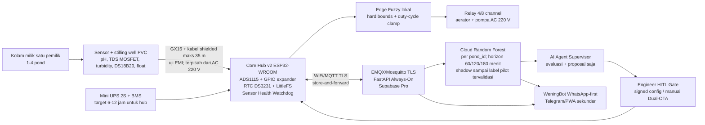

# Product Requirements Document — BanyuWening

**Versi:** 2.1 (Modular Multi-Pond + Hybrid Edge-Cloud AI)  
**Tanggal revisi:** 20 November 2026  
**Tim:** M. Ilham Nandari (PM/Fullstack), Gofran Muttaqi Likhan (IoT/Cloud/DB), Monika Lisbet Lase (Admin/QA)  
**Deadline:** 15 Januari 2027 (95 hari dari 12 Oktober 2026)

> **Catatan revisi yang mengikat:** Addendum §12 adalah sumber kebenaran untuk hardware v2, perilaku offline/PLN padam, peran Edge Fuzzy/Cloud Random Forest/AI Agent, kanal notifikasi, OTA, biaya cloud, target risiko, dan keselamatan. Addendum ini menggantikan bagian v2.0 yang bertentangan, termasuk eksekusi aktuator langsung oleh LLM dan klaim telemetri yang mengabaikan `pond_id`.

---

## 1. Latar Belakang dan Masalah

Pembudidaya ikan lele, patin, nila, dan udang skala kecil-menengah kehilangan puluhan juta rupiah per musim akibat kematian massal ikan yang terjadi tiba-tiba. Penyebabnya adalah penurunan kualitas air yang terjadi dalam hitungan jam — terutama antara tengah malam hingga fajar — sementara metode pemantauan yang ada masih manual dan reaktif: petambak baru menyadari masalah saat ikan sudah mengapung di permukaan.

Selain masalah pemantauan, terdapat **masalah kritis pada eksekusi mitigasi**:
- Petambak sering kali bingung menentukan tindakan korektif yang tepat ketika air memburuk (misal: apakah harus menyalakan aerator, mengalirkan air baru, menyalakan biofilter, atau meneteskan molase/karbon untuk mengontrol amonia dan pH).
- Perangkat kontrol aktuator di pasaran bersifat statis (on/off sederhana), kaku, dan tidak dapat dikonfigurasi secara modular seperti PLC (*Programmable Logic Controller*).
- Setiap tambak memiliki inventaris aktuator yang berbeda-beda tergantung kapasitas kolam.

**Solusi BanyuWening 2.0:**
Sistem terintegrasi **IoT Edge PLC Modular + Machine Learning (Random Forest) + LLM Reasoning Agent** yang:
1. Memantau parameter air (pH, suhu, TDS, turbiditas, level air) secara kontinu tiap 30 detik.
2. Memiliki antarmuka kontrol multi-relay modular (konsep Mini-PLC) yang dapat diinisialisasi dan dipetakan secara dinamis di dashboard (misal: Relay 1: Aerator, Relay 2: Pompa Kuras, Relay 3: Pompa Air Bersih, Relay 4: Pompa Dosing Molase/Probiotik, Relay 5: Filter Bio/UV).
3. Menggunakan **Random Forest / XGBoost** untuk *early warning* dan klasifikasi risiko cepat (Aman / Waspada / Bahaya).
4. Menghubungkan sistem ke **LLM AI Agent (Agentic Reasoning & Tool Calling)** yang membaca kondisi air, tren parameter, dan daftar aktuator terpasang, lalu secara otomatis merumuskan serta mengeksekusi rencana mitigasi terukur (misal: menyalakan pompa molase 3 menit dan aerator 30 menit), disertai penjelasan logis (*Explainable AI*) ke Telegram petambak.

---

## 2. Tujuan Produk

| # | Tujuan | Indikator Berhasil |
|---|--------|-------------------|
| 1 | Pemantauan kontinu 24/7 | Data tersimpan tanpa jeda > 2 menit selama normal |
| 2 | Deteksi dini & klasifikasi risiko | Model Random Forest/XGBoost klasifikasi Aman/Waspada/Bahaya, F1 ≥ 0,80 |
| 3 | Modular PLC Relay Controller | Sistem mendukung konfigurasi dinamis N-channel relay (4/8/16 channel via I2C/SPI/GPIO) |
| 4 | Mitigasi Otonom berbasis AI Agent | LLM Agent memanggil tool aktuator yang tepat < 15 detik setelah status Waspada/Bahaya |
| 5 | Keamanan & Guardrails Aktuator | Interlock deterministik mencegah aksi berbahaya (misal: kuras air saat level LOW) |
| 6 | Notifikasi Edukatif & XAI Telegram | Pesan penjelasan diagnosis + tindakan mitigasi terkirim < 10 detik ke petambak |
| 7 | Dashboard Web & PLC Mapper | Pengguna dapat memetakan fungsi relay, melihat penalaran AI, dan manual override |
| 8 | Keandalan Offline (Failsafe Lokal) | Rule darurat di ESP32 tetap mengaktifkan aerator lokal jika internet/cloud terputus |

---

## 3. Pengguna dan Peran

| Peran | Siapa | Kebutuhan Utama |
|-------|-------|-----------------|
| **Pemilik Kolam (Petambak)** | Pemilik/pengelola kolam | Melihat status risiko, menerima laporan mitigasi LLM di Telegram, konfirmasi aksi AI |
| **Operator Kolam** | Petugas teknis lapangan | Mengatur inisiasi/mapping relay PLC (menentukan relay mana terhubung ke alat apa), kendali manual, kalibrasi sensor |
| **Analis Akuakultur** | Pakar data/perikanan | Meninjau log keputusan mitigasi AI Agent, evaluasi efektivitas dosis/tindakan terhadap perbaikan air |
| **Super Administrator** | Tim pengembang/sysadmin | Manajemen akun, konfigurasi prompt agent, fine-tuning model ML, audit log sistem |

---

## 4. Ruang Lingkup

### Termasuk (In-scope)
- **Node Sensor ESP32:** Pembacaan pH, suhu, TDS, turbiditas, float level sensor.
- **Modul Multi-Relay PLC (Modular Actuator Controller):** Papan relay 4–8 channel (dengan isolasi optocoupler, ekspansi I2C PCF8574 / MCP23017) untuk mengontrol aneka perangkat (aerator, pompa sirkulasi, pompa kuras, pompa isi, dosing pump molase/probiotik, biofilter).
- **Inisiasi & Konfigurasi Aktuator Dinamis:** Tabel konfigurasi di Supabase dan antarmuka web untuk mapping: `Relay Port` $\rightarrow$ `Tipe Alat` $\rightarrow$ `Spesifikasi/Kapasitas` $\rightarrow$ `Safety Constraints (Max Duration, Interlock)`.
- **Fast-Layer ML (Random Forest Classifier):** Inferensi cepat untuk penentuan level risiko dan skor anomali berdasarkan fitur lag & slope parameter air.
- **Reasoning Layer (LLM AI Agent via Function Calling):** Agen cerdas (Google Gemini Flash / Claude / OpenAI) yang dilengkapi domain knowledge budidaya akuakultur untuk menyusun sekuens mitigasi sesuai alat yang aktif.
- **Safety Interlock & Execution Engine:** Gatekeeper deterministik yang memvalidasi output tool-call LLM sebelum mengirim perintah fisik ke relay (mencegah over-dosing atau korsleting beban).
- **Backend FastAPI:** Ingestion MQTT, orkestrasi ML + LLM Agent, REST API, Webhook Telegram.
- **Frontend Next.js:** Dashboard monitoring real-time, tab PLC Relay Mapper, visualisasi penalaran agent, manual override.
- **Telegram Interactive Bot:** Notifikasi status, ringkasan penalaran mitigasi AI, dan tombol darurat/approval (Human-in-the-loop).

### Tidak termasuk (Out-of-scope)
- Sensor optical DO industri berharga tinggi (tetap menggunakan proksi korelasi parameter air).
- Pembuatan perangkat keras PLC bersertifikasi industri IEC 61131-3 (menggunakan mikrokontroler ESP32 + optocoupler industrial shield).
- Kontrol aktuator berbasis analog proportional valve (hanya discrete on/off relay dengan modulasi durasi/PWM waktu).
- Model LLM dijalankan lokal di mikrokontroler (LLM berjalan di cloud via API).

---

## 5. Kebutuhan Fungsional

### 5.1 Node Sensor & Edge Controller (ESP32 Mini-PLC)

| ID | Kebutuhan |
|----|-----------|
| F-01 | Membaca sensor pH, suhu DS18B20, TDS, turbiditas, dan float switch setiap 30 detik dengan averaging 10x |
| F-02 | Komunikasi dengan I/O Expander (MCP23017 / PCF8574 via I2C) untuk mengendalikan multi-channel relay (4–8 channel) secara independen |
| F-03 | Format payload telemetri mencakup pembacaan sensor + status aktual seluruh channel relay (`relay_states: {"R1": true, "R2": false, ...}`) |
| F-04 | Menerima instruksi kontrol multi-relay dari topik MQTT `banyuwening/{device_id}/control` dengan schema terstruktur (`relay_id`, `state`, `duration_seconds`) |
| F-05 | **Hardware Watchdog & Relay TTL:** Setiap perintah aktivasi relay wajib memiliki batas durasi maksimum (*safety timeout*). Jika habis tanpa pembaruan, relay otomatis OFF |
| F-06 | **Failsafe Lokal Deterministik:** Jika parameter mencapai batas darurat (misal: pH < 6.0 atau suhu > 33°C) dan koneksi internet putus, ESP32 otomatis menyalakan relay yang terdaftar sebagai aerator |
| F-07 | Proteksi sensor gagal baca (`sensor_fault`): tidak mengeksekusi mitigasi kimiawi/molase jika sensor pH bernilai NaN |

### 5.2 Manajemen Konfigurasi Aktuator (Relay Initiator & Registry)

| ID | Kebutuhan |
|----|-----------|
| F-08 | **Relay Mapping Registry:** Database menyimpan metadata tiap relay per perangkat: `relay_number`, `assigned_device_type` (AERATOR, DRAIN_PUMP, FRESH_WATER_PUMP, MOLASSES_PUMP, PROBIOTIC_DOSER, BIOFILTER, HEATER), `device_name`, `flow_rate_lpm`, `max_runtime_seconds`, `cooldown_seconds`, `is_active` |
| F-09 | **Antarmuka Konfigurasi Web:** Operator dapat memetakan relay port ke fungsi alat, mengaktifkan/menonaktifkan port, dan menetapkan parameter keselamatan |
| F-10 | Sinkronisasi status konfigurasi antara cloud backend dan firmware ESP32 via MQTT retain message |

### 5.3 Backend & Dual-Tier AI Engine (Random Forest + LLM Agent)

| ID | Kebutuhan |
|----|-----------|
| F-11 | **Tier 1 - Fast ML Triage (Random Forest):** Menghitung laju perubahan ($dpH/dt$, $dTemp/dt$, $dTDS/dt$) dan memprediksi status risiko (Aman, Waspada, Bahaya) dalam waktu < 200ms |
| F-12 | **Agent Triggering Condition:** Jika Random Forest mendeteksi status "Waspada" atau "Bahaya", atau terjadi anomali multi-parameter, backend memicu eksekusi LLM AI Agent |
| F-13 | **Agent Context Assembly:** Backend menyusun context prompt: data telemetri terkini, tren 2 jam terakhir, hasil prediksi Random Forest, daftar aktuator terkonfigurasi beserta batas amannya |
| F-14 | **Aquaculture Domain Knowledge Base:** Agent dibekali pedoman mitigasi akuakultur standar (misal: penambahan molase untuk C:N ratio saat amonia/turbiditas naik, penambahan air baru saat TDS pekat, aerasi darurat saat suhu naik drastis) |
| F-15 | **Tool Calling / Function Calling:** AI Agent memanggil function: `execute_actuator_plan(actions=[{relay_id, action, duration_seconds, target_device, reason}])` |
| F-16 | **Deterministic Interlock Gatekeeper:** Sebelum perintah AI diteruskan ke MQTT, sistem backend memverifikasi terhadap aturan keselamatan fisik: (1) Pompa kuras dilarang aktif jika water level LOW, (2) Dosing molase tidak boleh melebihi batas kumulatif harian, (3) Aerator wajib aktif saat sirkulasi berjalan |
| F-17 | **Mitigation Audit Trail:** Menyimpan riwayat penalaran LLM (*thought process*, prompt, output tools, status validasi gatekeeper, hasil eksekusi) ke tabel `agent_mitigation_logs` |

### 5.4 Dashboard Web (Next.js)

| ID | Kebutuhan |
|----|-----------|
| F-18 | **Panel PLC Relay Configurator:** Grid antarmuka untuk inisiasi relay port, mapping jenis alat, status switch live, dan pengujian manual |
| F-19 | **Monitoring Real-time & Telemetri:** Grafik tren sensor interaktif dengan polling/realtime WebSocket |
| F-20 | **Live Agent Thought Box:** Menampilkan kartu analisis AI terkini yang menjelaskan mengapa AI memilih mengaktifkan alat tertentu dalam bahasa manusia yang mudah dipahami |
| F-21 | **Emergency Kill Switch:** Tombol darurat di dashboard untuk mematikan seluruh relay seketika (*All-OFF*) dan menonaktifkan kontrol otonom AI |
| F-22 | Riwayat log mitigasi: tabel interaktif berisi waktu kejadian, parameter pemicu, tindakan yang diambil AI, dan respons parameter air setelah mitigasi |

### 5.5 Notifikasi Interaktif Telegram

| ID | Kebutuhan |
|----|-----------|
| F-23 | Pesan terstruktur mencakup: Level Risiko (dari Random Forest), Anomali Terdeteksi, Keputusan Mitigasi AI, Daftar Alat yang Dinyalakan (beserta estimasi durasi) |
| F-24 | Mode Operasi: (A) *Autonomous Execution* (AI mengeksekusi langsung dan memberi tahu petambak), atau (B) *Human-in-the-Loop Approval* (AI merekomendasikan tombol inline Telegram: `[Setujui & Jalankan]` / `[Tolak]`) |
| F-25 | Notifikasi penyelesaian: Telegram mengirim pesan saat durasi kerja relay selesai, melaporkan kondisi akhir kualitas air |

---

## 6. Kebutuhan Non-Fungsional

| Kategori | Spesifikasi |
|----------|-------------|
| **Keamanan Listrik & Isolasi** | Modul relay wajib dilengkapi isolasi optocoupler; flyback diode/snubber untuk beban induktif pompa 12V DC guna mencegah induksi balik (*back-EMF*) yang dapat me-reset ESP32 |
| **Separasi Catu Daya** | Jalur daya 12V untuk koil relay dan motor pompa dipisahkan dari jalur daya 3.3V/5V logika mikrokontroler (menggunakan step-down independen) |
| **Batas Waktu Inferensi AI** | Total siklus (Sensor $\rightarrow$ Ingestion $\rightarrow$ Random Forest $\rightarrow$ LLM Agent Reasoning $\rightarrow$ Validasi Gatekeeper $\rightarrow$ MQTT Command) selesai dalam $\le 15$ detik |
| **Efisiensi Token LLM** | Format prompt agent dibuat ringkas berbasis skema JSON terkompresi; cooldown pemanggilan LLM minimal 10 menit untuk kondisi anomali yang sama guna menghemat biaya API |
| **Fail-Safe Fallback** | Jika API LLM timeout/gagal (HTTP 5xx / kuota habis), sistem otomatis beralih ke aturan deterministik (*Rule-based Fallback Matrix*) tanpa interupsi |
| **Enclosure Proteksi** | Box panel modular IP65 dengan terminal block untuk perkabelan relay yang rapi dan aman dari kelembapan kolam |

---

## 7. Matriks Pengetahuan Mitigasi Akuakultur (Basis Aturan AI Agent)

Tabel berikut menjadi pedoman domain (*System Knowledge*) yang digunakan oleh LLM Agent dan Deterministic Gatekeeper:

| Kondisi Parameter | Analisis Masalah Akuakultur | Tindakan Mitigasi AI (Aktuator yang Dipilih) | Catatan & Batasan Keamanan |
|-------------------|-----------------------------|---------------------------------------------|-----------------------------|
| **pH Anjlok (< 6.2)** secara cepat, TDS stabil | Akumulasi asam organik atau hujan asam | 1. Nyalakan Pompa Dosing Buffer/Kapur (durasi bertahap)<br>2. Nyalakan Aerator untuk pelepasan $CO_2$ | Jangan dosing kapur jika level air surut |
| **pH Melonjak (> 8.8)** pada siang/sore | Blooming alga (fotosintesis intensif menyerap $CO_2$) | 1. Nyalakan Pompa Sirkulasi/Filter<br>2. Tambahkan air baru dari sumur (Relay Pompa Air Bersih) | Pastikan float switch tidak mentok atas (anti-luber) |
| **Turbiditas Tinggi (> 120 NTU)** & bau amonia | Feses ikan dan sisa pakan membusuk di dasar kolam | 1. Nyalakan Pompa Dosing Molase (sumber karbon untuk menstimulasi bakteri heterotrof)<br>2. Nyalakan Aerator maksimal (bakteri butuh oksigen tinggi) | Dosing molase wajib dibatasi kuota volume per 24 jam |
| **Suhu Air Tinggi (> 32°C)** pada siang terik | Penurunan kelarutan oksigen & stres metabolik ikan | 1. Nyalakan Pompa Sirkulasi air bawah<br>2. Aktifkan Sprinkler/Aerator kabut permukaan | Pantau ketersediaan air pasokan |
| **TDS Terlalu Tinggi (> 800 ppm)** | Penumpukan zat terlarut pekat dan mineral limbah | 1. Buka Pompa Kuras (*Drain*) selama $t$ detik<br>2. Nyalakan Pompa Air Bersih (*Fresh Water Intake*) | **Interlock:** Kuras dan Isi tidak boleh berbenturan tanpa monitoring level |

---

## 8. Arsitektur Sistem BanyuWening 2.0

```
┌─────────────────────────────────────────────────────────────────────────────┐
│                             AREA KOLAM & HARDWARE                           │
│                                                                             │
│  [Sensors: pH, Temp, TDS, Turbidity, Float]                                │
│                     │                                                       │
│                     ▼ (ADC 10x Avg)                                         │
│            ┌─────────────────┐                                              │
│            │   ESP32 MCU     │ ◄─── Fail-safe Rule Engine (Offline Backup)  │
│            └────────┬────────┘                                              │
│                     │ I2C Bus                                               │
│                     ▼                                                       │
│            ┌─────────────────┐                                              │
│            │ MCP23017 / I2C  │                                              │
│            │ 8-Channel Relay │                                              │
│            └────────┬────────┘                                              │
│                     │ Optocoupler Isolated Relays                           │
│        ┌────────────┼─────────────┬─────────────┬─────────────┐             │
│        ▼            ▼             ▼             ▼             ▼             │
│   [Aerator]   [Pompa Kuras]  [Pompa Isi]  [Pompa Molase]  [Biofilter]       │
└────────┬──────────────────────────────────────────────────────▲─────────────┘
         │ MQTT TLS (Telemetri 30s)                             │ MQTT TLS (Commands)
         ▼                                                      │
┌───────────────────────────────────────────────────────────────┴─────────────┐
│                           CLOUD BACKEND (FastAPI)                           │
│                                                                             │
│  1. Ingestion & Validation ──► Simpan ke Supabase PostgreSQL               │
│                                                                             │
│  2. [TIER 1] Fast Risk Triage:                                              │
│     └── Random Forest / XGBoost Model                                       │
│         ├── Status: Aman (Keep Monitoring)                                  │
│         └── Status: Waspada / Bahaya ──┐                                    │
│                                        ▼                                    │
│  3. [TIER 2] LLM Autonomous Agent Orchestration:                            │
│     ├── Query Actuator Registry (Relay mana saja yang aktif & terhubung)    │
│     ├── Inject Aquaculture Mitigation System Prompt                         │
│     ├── LLM Tool Calling (Pilih aktuator, urutan, & durasi)                │
│     └── Deterministic Safety Gatekeeper (Validasi batas interlock fisik)    │
│               │                                                             │
│               ├────────► Terbitkan Perintah Eksekusi Relay via MQTT        │
│               └────────► Kirim Laporan XAI ke Telegram Bot Petambak         │
└──────────────────────────────────────┬──────────────────────────────────────┘
                                       │ REST / Supabase Realtime
                                       ▼
┌─────────────────────────────────────────────────────────────────────────────┐
│                         DASHBOARD WEB (Next.js 15)                          │
│                                                                             │
│  - Monitoring Grafik Sensor Real-Time                                       │
│  - Tab Inisiasi & Konfigurasi PLC Relay (Actuator Mapping Matrix)           │
│  - Live AI Reasoning Log (Penjelasan transparansi aksi mitigasi)            │
│  - Manual Override & Emergency Emergency All-OFF                            │
└─────────────────────────────────────────────────────────────────────────────┘
```

---

## 9. Skema Data & Kontrak Integrasi Tambahan

### 9.1 Tabel Konfigurasi Relay (`actuator_configs`)
```sql
create table actuator_configs (
  id uuid primary key default gen_random_uuid(),
  device_id text not null references devices(id),
  relay_channel int not null,                 -- 1 sampai 8
  actuator_type text not null,                -- 'AERATOR', 'MOLASSES_PUMP', 'DRAIN_PUMP', 'FRESH_PUMP', 'BIOFILTER'
  custom_label text not null,                 -- 'Pompa Dosing Molase Kolam A'
  flow_rate_lpm numeric default 0,            -- Kapasitas liter/menit (opsional)
  max_runtime_seconds int not null default 300, -- Batas aman sekali jalan (default 5 menit)
  cooldown_seconds int not null default 600,  -- Jeda minimum sebelum boleh jalan lagi
  is_active boolean not null default true,
  updated_at timestamptz default now(),
  unique (device_id, relay_channel)
);
```

### 9.2 Tabel Audit Log Mitigasi AI (`agent_mitigation_logs`)
```sql
create table agent_mitigation_logs (
  id uuid primary key default gen_random_uuid(),
  device_id text not null references devices(id),
  triggered_by text not null,                  -- 'RANDOM_FOREST_WASPADA', 'RANDOM_FOREST_BAHAYA', 'MANUAL_TEST'
  telemetry_snapshot jsonb not null,           -- {ph: 5.9, temp: 31.2, tds: 420, turbidity: 145}
  llm_reasoning_thought text not null,         -- Penjelasan mengapa agent memilih tindakan tsb
  proposed_actions jsonb not null,             -- Array aksi yang diusulkan oleh LLM
  gatekeeper_approved boolean not null,        -- Apakah lolos verifikasi keselamatan?
  gatekeeper_rejection_reason text,           -- Jika ditolak, apa alasannya?
  executed_commands jsonb,                    -- Perintah final yang dikirim ke MQTT
  created_at timestamptz default now()
);
```

### 9.3 Kontrak Payload Kontrol PLC via MQTT
```json
{
  "cmd_id": "act-9a2c",
  "device_id": "BANYUWENING-01",
  "source": "AI_AGENT",
  "actions": [
    {
      "channel": 1,
      "actuator": "AERATOR",
      "state": "ON",
      "duration_s": 1800
    },
    {
      "channel": 4,
      "actuator": "MOLASSES_PUMP",
      "state": "ON",
      "duration_s": 180
    }
  ],
  "reason": "pH drop tajam ke 5.9 dan turbiditas 145 NTU. Dosing molase 3 menit + aerasi 30 menit untuk aktivasi bio-remediasi."
}
```

---

## 10. Milestone dan Penyesuaian Jadwal Proyek

| Fase | Deliverable Utama | Mulai | Selesai | Catatan Khusus |
|------|-------------------|-------|---------|----------------|
| **Fase 1: Hardware & PLC Board** | Integrasi ESP32 + I2C Relay Module 4–8 Ch, uji isolasi beban, firmware basic MQTT | 26/10/2026 | 15/11/2026 | Uji snubber / diode pada motor pompa |
| **Fase 2: Logging & Training ML** | Pengumpulan data sensor, training model Random Forest & evaluasi metrik | 09/11/2026 | 06/12/2026 | Pelabelan status Aman/Waspada/Bahaya |
| **Fase 3: Agentic Reasoning & Backend** | FastAPI + Random Forest + Integrasi LLM Tool Calling + Deterministic Safety Gatekeeper | 07/12/2026 | 22/12/2026 | Pengujian skenario mitigasi molase & pompa |
| **Fase 4: Dashboard PLC & Telegram** | UI Mapper Konfigurasi Relay di Next.js, log XAI, Telegram Bot approval/interactive | 23/12/2026 | 05/01/2027 | Integrasi Supabase Realtime |
| **Fase 5: Uji Lapangan & Serah Terima** | End-to-end stress test di kolam nyata, simulasi sensor fault, dokumentasi final | 06/01/2027 | 15/01/2027 | Validasi keamanan kelistrikan |

---

## 11. Risiko Khusus & Mitigasi Tambahan BanyuWening 2.0

| Risiko | Dampak | Strategi Mitigasi |
|--------|--------|-------------------|
| **Halusinasi LLM pada Dosis/Durasi** | Pompa molase atau pengurasan berjalan terlalu lama | **Deterministic Gatekeeper:** LLM dilarang menulis angka durasi mentah ke pin. Kode backend membatasi durasi maksimal sesuai batas aman `max_runtime_seconds` di tabel konfigurasi. |
| **Noise Listrik (Back-EMF) dari Pompa** | ESP32 mendadak hang / restart (*brownout*) saat relay pompa menyala | Pasang kapasitor decoupling, flyback diode (1N4007) paralel pada motor DC, dan pisahkan ground koil relay dari ground ESP32 melalui optocoupler. |
| **Biaya Token & Latensi LLM** | Tagihan API membengkak, respons lambat | Hanya panggil LLM saat status berubah menjadi Waspada/Bahaya (tidak dipanggil setiap 30 detik). Gunakan model kencang dan hemat seperti Gemini 2.0 Flash atau GPT-4o-mini. |
| **Internet Kolam Putus Saat Mitigasi** | Cloud tidak bisa mematikan relay yang sedang ON | Firmware ESP32 memiliki timer internal (*Hardware Watchdog*). Relay otomatis OFF setelah `duration_s` habis meskipun koneksi cloud putus. |
| **Relay Port Salah Colok oleh Operator** | Pompa molase tercolok ke port aerator | Fitur "Test Pulse 3 Detik" di dashboard saat inisiasi alat agar operator dapat memastikan alat fisik yang bereaksi sudah sesuai sebelum dioperasikan secara otomatis. |

---

## 12. Addendum Normatif v2.1 — Modular Multi-Kolam dan Hybrid Edge-Cloud

Addendum ini menggantikan persyaratan v2.0 yang bertentangan. Istilah “1–3 jam”, “6–12 jam”, dan “4–6 bulan” di bawah merupakan pembacaan rentang yang konsisten dari naskah revisi (yang sempat tertulis “13 jam”, “612 jam”, dan “46 bulan”). Rentang runtime UPS dan umur probe tetap **target/estimasi yang harus dibuktikan lewat uji lapangan**, bukan jaminan performa.

### 12.1 Produk dan paket hardware v2

Satu **Core Hub v2 melayani hingga empat kolam milik satu pemilik** dalam satu lokasi. Klaim patungan antar-tetangga bukan bagian produk. Konektor sensor menggunakan GX16 kedap air dan kabel shielded maksimal 35 m; jalur kabel sensor harus dipisahkan dari kabel AC 220 V. Jarak tersebut menjadi batas desain yang wajib lulus uji noise, grounding, proteksi surge, dan akurasi ADC pada konfigurasi lapangan.

| Komponen | Spesifikasi v2 | Biaya dan batas paket |
|---|---|---|
| Core Hub v2 | Custom carrier PCB, ESP32-WROOM dengan modul pre-certified SDPPI; proses sertifikasi perangkat jadi ke SDPPI/DJID Komdigi direncanakan; RTC DS3231, LittleFS, LCD 16x2, box IP65, empat port chassis GX16, GPIO expander MCP23017/PCF8574, level shifter 3.3 V/5 V, dan mini UPS 2S dua sel 18650 + BMS | COGS Rp595.000; harga satuan Rp900.000 |
| Starter 2K | Dua ADS1115 (8 input ADC); empat relay; dua soket GX16 aktif dari empat; kapasitas dua kolam, dua aktuator per kolam | Jumlah kanal dan batas beban harus dikonfirmasi pada uji integrasi |
| Juragan 4K + Expansion Kit | Tiga ADS1115 (12 input ADC); delapan relay optocoupler; empat port aktif; kapasitas empat kolam, dua aktuator per kolam | Setiap ADS1115 harus memakai alamat I2C unik. Tiga alamat yang direncanakan: 0x48, 0x49, 0x4A; verifikasi skematik ADDR dan konflik alamat sebelum PCB dipesan. ADS1115 menyediakan empat input single-ended per IC. |
| Modul Sensor Kolam v2 | Probe pH PH-4502C, DS18B20 1-Wire, TDS dengan MOSFET power-switch, turbidity ber-potting epoxy di stilling well PVC, float switch, kabel shielded dan filter EMI RC/ferrite | COGS Rp535.000; harga satuan Rp800.000 |

ADS1115 memiliki empat alamat I2C yang dapat dipilih melalui pin ADDR dan empat input single-ended; lihat [datasheet Texas Instruments ADS1115](https://www.ti.com/lit/ds/symlink/ads1115.pdf). Desain 35 m harus diuji sebagai satu sistem sensor-kabel-front-end; angka tersebut bukan jaminan bahwa jalur I2C mentah boleh dipanjangkan sejauh itu.

Probe pH kaca dan elektroda TDS merupakan **consumable**, bukan bagian garansi elektronik. Garansi 12 bulan hanya untuk Core Hub dan modul kering IP65; probe mendapat garansi DOA 30 hari. Harga pengganti resmi Rp195.000/probe. Estimasi umur 4–6 bulan di lumpur lele perlu dicatat sebagai hasil pilot dan tidak dijanjikan sebelum data lapangan memadai. Sensor DO dan NH3 tidak termasuk paket standar; ekspansi DO Pro disediakan melalui slot I2C/GX16.

### 12.2 Operasi lokal, Store-and-Forward, dan catu daya

| Kondisi | Perilaku wajib |
|---|---|
| WiFi/internet putus, PLN tersedia | Edge Fuzzy dan safety clamp tetap berjalan di ESP32; relay lokal beroperasi; pembacaan, fault, keputusan fuzzy, dan status relay dicatat ke LittleFS dengan timestamp RTC DS3231. Data dikirim ulang berurutan setelah koneksi pulih. |
| SaaS/backend berhenti | Mode Offline-Plus tetap berfungsi tanpa biaya cloud: pembacaan, aturan lokal, relay lokal, LCD, RTC, dan log lokal tetap aktif. Tidak ada ketergantungan cloud untuk fungsi keselamatan. |
| PLN padam | Mini UPS 2S menjaga Core Hub, RTC, dan pencatatan LittleFS tetap hidup dengan target 6–12 jam melalui LCD backlight off dan duty-cycle sensor. Peringatan “Listrik PLN Padam” dikirim hanya jika router/gateway dan uplink masih memiliki daya. |
| PLN padam tanpa genset/inverter beban | Aerator dan pompa AC 220 V **tidak berjalan**. UPS Core Hub tidak boleh dipasarkan seolah-olah menjadi backup daya aktuator AC. |

### 12.3 Fuzzy edge, sensor watchdog, dan adaptasi terkendali

Edge Fuzzy deterministik menjadi kendali lokal utama untuk aerator/pompa. Prioritas operasi: **hard safety bounds dan interlock > proteksi perangkat > kontrol Fuzzy lokal > perintah cloud yang tervalidasi > kontrol manual yang berotorisasi**. Semua relay memiliki maksimum durasi, cooldown, dan duty-cycle clamp; tidak ada perintah yang dapat mempertahankan relay aktif tanpa batas.

Sensor Health Watchdog memberi status `OK`, `SATURATED`, atau `FAULT` berdasarkan flatline, stuck-at-rail, nilai di luar rentang fisik, dan kegagalan komunikasi. Kanal bermasalah ditandai missing dan diisolasi dari keputusan Fuzzy/RF; sistem menurunkan tingkat keyakinan, memakai fitur sensor sehat yang tersisa, mencatat degradasi, dan memberi notifikasi perawatan. Watchdog dapat mendeteksi dan mengisolasi probe kotor/rusak, tetapi **tidak dapat memperbaiki kerusakan fisik probe**.

Metode self-improvement yang disetujui adalah **bounded self-tuning Fuzzy**, bukan pembelajaran bebas pada jalur relay:

1. Aturan inti, emergency limits, arah tindakan, interlock, durasi maksimum, dan duty-cycle clamp dikunci sebagai hard constraints.
2. Setelah kalibrasi awal, ESP32 menghitung baseline lokal per pond dari rolling median/MAD dan siklus diurnal pada jendela data valid (awal: tujuh hari). Baseline ini boleh menggeser pusat/lebar membership “normal” secara kecil dan bertahap; batas fisik dan zona bahaya tidak boleh bergeser.
3. Adaptasi dibekukan saat sensor fault/saturated, alarm aktif, kalibrasi berlangsung, relay sedang menjalankan mitigasi, atau sampel dinilai tidak valid. Perubahan parameter dicatat sebagai versi usulan di LittleFS.
4. Untuk cohort model, data pilot 90 hari diberi label melalui DO meter dan test kit amonia yang dikalibrasi. Kandidat tuning Fuzzy dapat dilatih di cloud dengan ANFIS (hybrid gradient descent + least-squares) atau optimasi parameter terikat, kemudian diuji pada split waktu yang belum dilihat dan skenario batas keselamatan.
5. AI Agent Supervisor hanya mengevaluasi telemetri, kualitas model, dan kandidat konfigurasi serta menulis rekomendasi/audit; **agent tidak melatih ulang atau menerapkan model sendiri**. Pipeline training terpisah membangun kandidat. Engineer wajib menyetujui konfigurasi sebelum signed JSON dikirim ke MQTT.
6. ESP32 memvalidasi signature/version, hard bounds, duty-cycle clamp, skema, dan compatibility; config ditulis atomik dengan versi sebelumnya untuk rollback. Level 2 Dual-OTA hanya dipicu manual Engineer; kegagalan health check dalam 60 detik mengaktifkan auto-rollback.

ANFIS diperkenalkan sebagai adaptive-network-based fuzzy inference dengan pembelajaran hybrid: least-squares untuk parameter konsekuen dan gradient descent untuk parameter premise; mode batch dan pattern/online dibahas dalam paper asli Jang 1993 ([paper ANFIS](https://www.cic.ipn.mx/~pescamilla/SistInt/Jang1993.pdf)). Pada BanyuWening, pembaruan online hanya boleh menyentuh baseline/membership normal yang dibatasi. Tidak boleh ada reinforcement-learning langsung yang bereksperimen pada aktuator kolam. Tanpa label DO/NH3 yang tervalidasi, “self-learning” hanya berarti adaptasi baseline/anomali lokal, bukan pembuktian kondisi biologis ikan.

### 12.4 Cold start, label risiko, dan Cloud Random Forest

Pada cold start sampai tersedia pilot berlabel, Edge Fuzzy deterministik + Relative Local Anomaly Detection menjadi satu-satunya kontrol. Cloud RF dapat berjalan dalam **shadow mode**, tetapi status model wajib “belum tervalidasi” dan hasilnya tidak menggerakkan relay.

Paket standar tidak memiliki sensor DO dan amonia. Proxy RF mencakup pH, suhu, TDS, turbiditas, laju perubahan/lag, fitur siklus diurnal, status kesehatan sensor, dan missingness. Nilai DO/NH3 yang dikumpulkan dari DO meter/test kit pada pilot berfungsi sebagai ground truth offline, bukan sebagai sensor kontinu yang seolah-olah tersedia di paket standar.

Tujuan cloud: Random Forest terpisah per `pond_id` memprediksi status **AMAN/WASPADA/BAHAYA** pada horizon 1, 2, dan 3 jam. Definisi label dan ambang kelas harus dikunci bersama ahli budidaya dan sumber yang tercatat sebelum training produksi. Sebagai rentang dasar budidaya air tawar, dokumen teknis BSIP yang mengutip SNI mencantumkan suhu 25–30 °C, pH 6,5–8,5, DO minimal 4 mg/L, dan NH3 maksimal 0,01 mg/L untuk lele; lihat [petunjuk teknis BSIP Kementerian Pertanian](https://lahanrawa.bsip.pertanian.go.id/storage/assets/uploads/publikasi/VxKAveS8lfXXnD6UEhW77QANsI0KkTfyKn13DCQP.pdf). Ambang warning/danger, perubahan cepat, TDS, dan turbiditas tetap harus ditetapkan/ditinjau pakar dan divalidasi pada kondisi kolam lokal; nilai lama di kode tidak otomatis menjadi standar ilmiah.

Training RF memakai data per `pond_id`, horizon target yang eksplisit, chronological holdout, class imbalance handling bila perlu, calibration/performance report, model card, dan monitoring drift. Tidak ada klaim F1 ≥0,80 sebelum diuji pada data pilot independen. Jika hasil model menurun atau sensor tidak sehat, fallback ke Fuzzy lokal dan kirim label “model tidak tersedia/terdegradasi”. Agent mengevaluasi hasil dan boleh mengusulkan pekerjaan retraining, tetapi tidak melakukan self-training/push otomatis.

### 12.5 Cloud, kontrak multi-pond, dan channel adapter

Cloud produksi menggunakan EMQX atau Mosquitto dengan TLS, FastAPI Always-On, dan Supabase Pro. Hub memiliki `device_id`; setiap telemetri, prediksi, konfigurasi, relay, fault, dan log wajib mengandung `pond_id`. Semua key, unique constraint, RLS, query, payload MQTT, API, model, dan dashboard harus mendukung maksimal empat `pond_id` per `device_id`.

Topik minimum:

| Topik | Arah | Isi |
|---|---|---|
| `banyuwening/{device_id}/{pond_id}/telemetry` | Hub → cloud | Data sensor, health, fuzzy decision, relay state, sequence, timestamp |
| `banyuwening/{device_id}/{pond_id}/status` | Hub → cloud | Status online/offline, daya, WiFi, firmware, config/model version |
| `banyuwening/{device_id}/{pond_id}/control` | Cloud → hub | Usulan/command yang tervalidasi, `cmd_id`, TTL, pond dan channel |
| `banyuwening/{device_id}/{pond_id}/ack` | Hub → cloud | Accepted/rejected, alasan safety clamp, relay state aktual |
| `banyuwening/{device_id}/{pond_id}/config/candidate` | Cloud → hub | Signed config candidate yang sudah mendapat HITL approval; bukan output bebas agent |

Diagram v2.1 berikut menggantikan diagram arsitektur lama di §8:



Pada PLN padam, UPS hanya menjaga hub/log dan jalur peringatan yang masih memiliki uplink; relay tidak dapat memberi daya pada aerator/pompa AC tanpa inverter/genset eksternal.

Pembacaan lokal dilakukan tiap 30 detik; upload cloud diagregasi tiap 5 menit untuk skala 320 kolam (sekitar 2,76 juta record per bulan sebelum overhead). Raw/store-forward dan agregat wajib mempunyai retensi dan partisi yang ditetapkan agar histori operasional 90 hari dapat dipertahankan. Angka kapasitas dan biaya diverifikasi melalui load test dan estimasi storage/index Supabase Pro.

Channel Adapter **WhatsApp-first** menjadi kanal pengguna utama melalui WeningBot. Telegram dan PWA tetap kanal sekunder. Pesan memuat `pond_id`, status, confidence, fault, sumber keputusan (Fuzzy/RF/operator), dan tindakan yang disarankan. Notifikasi PLN padam dibedakan tegas dari WiFi offline.

### 12.6 Sasaran penerimaan v2

- Satu Core Hub mengelola satu sampai empat kolam milik satu pemilik; konfigurasi dua dan empat kolam lulus uji terpisah.
- WiFi diputus: keputusan Fuzzy, relay, dan log lokal tetap bekerja; seluruh backlog terunggah berurutan setelah koneksi pulih tanpa duplikasi.
- PLN diputus: Core Hub tetap log sesuai target UPS yang telah diuji; dokumentasi dan antarmuka menyatakan aerator/pompa AC berhenti kecuali sumber AC eksternal tersedia.
- Fault, saturation/flatline, dan sensor recovery menghasilkan status/audit dan tidak menyebabkan relay menyala tanpa batas.
- Safety bounds, duty-cycle clamp, TTL, rollback config, HITL config approval, dan manual Engineer OTA lolos uji fault-injection.
- Cloud memproses `pond_id`, model version, horizon, dan source dataset secara eksplisit; RF belum tervalidasi tidak pernah memberi command langsung.
- Broker TLS/FastAPI/Supabase Pro lulus load test target 320 kolam dan skenario backlog reconnect.
- WhatsApp-first notification mengirim event kritis, WiFi offline/recovery, PLN outage (bila gateway berdaya), dan sensor maintenance.

### 12.7 Jumlah kanal sensor dan evaluasi kecocokan dataset Kaggle

Satu Modul Sensor Kolam v2 memiliki **lima jenis kanal sensor**: (1) pH analog, (2) suhu DS18B20 digital 1-Wire, (3) TDS analog dengan MOSFET power-switch, (4) turbiditas analog, dan (5) float switch digital untuk level air. Tiga kanal pertama/ketiga analog yang memerlukan pembacaan ADC adalah pH, TDS, dan turbiditas; suhu serta float adalah kanal digital. Sensor DO dan amonia bukan bagian dari paket standar. DO meter dan test kit amonia/nitrit pada pilot adalah instrumen rujukan manual untuk ground-truthing.

Pencarian indeks Kaggle melalui Kaggle CLI pada 20 November 2026 menggunakan beberapa query sensor (`pH`, `TDS`, `turbidity`, `water level`, `DS18B20`) serta query tujuan (`aquaculture/fish pond`, `catfish`, `water quality`, `contamination`, `health risk`, `time series`). **Tidak ditemukan dataset yang secara terverifikasi memuat kelima kanal standar sekaligus dan target risiko lele pada horizon 1-3 jam.** Karena itu dataset publik hanya dapat menjadi bahan prototipe/benchmark; tidak memenuhi syarat model produksi per kolam dan tidak menggantikan pilot lokal berlabel.

| Dataset Kaggle yang diperiksa | Kanal relevan yang didokumentasikan | Kesesuaian tujuan dan keputusan |
|---|---|---|
| [Sensor Based Aquaponics Fish Pond Datasets](https://www.kaggle.com/datasets/ogbuokiriblessing/sensor-based-aquaponics-fish-pond-datasets) | Catfish; DS18B20/suhu, pH, turbiditas, plus DO, amonia, nitrat; tidak ada TDS/float | Kandidat tujuan terdekat untuk telemetry catfish multi-kolam. Tidak memiliki label risiko 1-3 jam. Dipakai hanya untuk prototipe prediksi proxy horizon dari pH/suhu, setelah watchdog menolak nilai sensor tidak fisik. CC BY 4.0. |
| [IoT Monitoring of Water Quality and Tilapia](https://www.kaggle.com/datasets/jocelyndumlao/iot-monitoring-of-water-quality-and-tilapia) | pH, suhu, turbiditas, DO; tidak ada TDS/float; target `Health Status` tersedia | Kandidat target kesehatan dini terdekat, tetapi spesiesnya tilapia dan bukan lele. Hanya benchmark eksternal, dengan fitur paket standar yang tersedia saja dan status target masa depan. CC0-1.0. |
| [A Simple Dataset of Aquaponic Fish Pond IoT](https://www.kaggle.com/datasets/bobsis/small-aquaculture-fishpond) | pH, TDS, suhu; tidak ada turbiditas/float | Kecocokan kanal parsial tertinggi (3 dari 5), tetapi tidak memiliki target risiko masa depan; tidak dipakai sebagai evaluasi klasifikasi risiko. CC BY 4.0. |
| [Fish Pond Water Contamination Dataset](https://www.kaggle.com/datasets/apgopi/fish-pond-water-contamination-dataset) | pH, suhu, turbiditas, DO, amonia, nitrat, mangan; tidak ada TDS/float | Tujuan kontaminasi kolam dekat, tetapi lisensi Kaggle tercatat unknown. Tidak disalin ke dataset kerja atau dipakai untuk training. |

Pada benchmark catfish, kelas risiko proxy dihitung dari **nilai masa depan pH dan suhu** pada horizon yang diuji; hanya pH, suhu, dan turbiditas saat ini menjadi fitur. Ambang dasar mengikuti rentang pH/suhu dalam §12.4 dan kelas dicatat sebagai proxy teknik, bukan label biologis. Nilai sensor di luar rentang fisik, misalnya suhu sentinel -127 °C, pH di luar rentang 0-14, atau turbidity di luar 0-100 NTU, dikeluarkan dan dicatat sebagai fault. Dataset tilapia memakai target `Health Status` masa depan yang disediakan sumber; ia tidak dianggap validasi lele. Tidak ada fitur TDS/float/DO yang diada-adakan atau diimputasi sebagai kanal pengukuran. Hasil kedua benchmark harus dilaporkan terpisah dan tidak digabung menjadi satu skor.

Dataset Kaggle publik, terutama dataset dengan kanal sensor parsial, target proxy, spesies lain, atau sensor bermasalah, **tidak boleh menjadi dasar klaim akurasi produksi, otomatisasi relay, atau klaim sensor yang sama dengan BOM**. Aktivasi cohort model tetap memerlukan pilot 90 hari per `pond_id` dengan label pembanding DO meter/test kit, validasi ahli, split kronologis, dan persetujuan engineer.


### 12.8 Hasil tuning jumlah pohon Random Forest (20 November 2026)

Pada benchmark Kaggle eksploratif, jumlah pohon diuji pada 100/200/300/500/800 menggunakan 3-fold chronological TimeSeriesSplit pada 15 kombinasi seri/horizon (45 fold). Aturan pemilihan adalah ukuran terkecil dalam toleransi 0,005 dari mean macro-F1 validasi tertinggi. Hasilnya menetapkan **100 pohon**: mean CV macro-F1 0,554153, hanya 0,000561 di bawah puncak 0,554714 pada 800 pohon. Perbandingan holdout 100 vs 300 pada 15 model memberi mean macro-F1 0,436046 vs 0,435485; waktu fit 300 pohon rata-rata 2,71x lebih tinggi. Mean gap train-validasi sekitar 0,349 pada seluruh ukuran, sehingga penambahan pohon tidak menyelesaikan masalah generalisasi.

Nilai ini adalah baseline shadow benchmark dari dataset publik dengan label proxy, bukan target performa produksi atau bukti bahwa data kolam baru akan akurat. Model tetap dilarang mengendalikan aktuator sampai ada label pilot tervalidasi dan evaluasi eksternal lintas waktu/pond. Rincian serta artefak tuning dicatat di `brief/parameter & weight.md` dan `random_forest_prd_update_experiment/results/comparison/`.

### 12.9 Matriks status sensor dan batas label benchmark

| Parameter | AMAN | WASPADA | BAHAYA | Status dalam label benchmark publik |
|---|---|---|---|---|
| Suhu | 25-30 C | 22-<25 C atau >30-33 C | <22 C atau >33 C | Dipakai |
| pH | 6,5-8,5 | 6,0-<6,5 atau >8,5-8,8 | <6,0 atau >8,8 | Dipakai |
| TDS | Dalam rentang lokal tervalidasi | Menyimpang dari baseline | Penyimpangan ekstrem | Belum dipakai untuk label |
| Turbiditas | Dalam rentang lokal tervalidasi | Meningkat dari baseline | Peningkatan ekstrem | Belum dipakai untuk label |
| Ketinggian air | Dalam batas operasional kolam | Mendekati batas minimum/maksimum | Keluar dari batas operasional | Belum dipakai; tidak tersedia di Kaggle benchmark |

Rentang suhu dan pH mengikuti SNI 8228.4:2015 sebagaimana disepakati pada spesifikasi ini. Nilai ambang TDS, turbiditas, dan ketinggian air tidak boleh diisi dengan angka universal atau dipakai untuk auto-control sebelum setiap `pond_id` memiliki periode baseline, batas operasi yang disetujui ahli/operator, dan hasil validasi lapangan. Pada benchmark publik, TDS dan turbiditas yang tersedia boleh menjadi fitur; mereka tidak menentukan kelas target. Dengan demikian target `future_proxy_risk` saat ini secara eksplisit merupakan proxy masa depan berbasis pH+suhu, bukan status biologis lengkap lima sensor.
