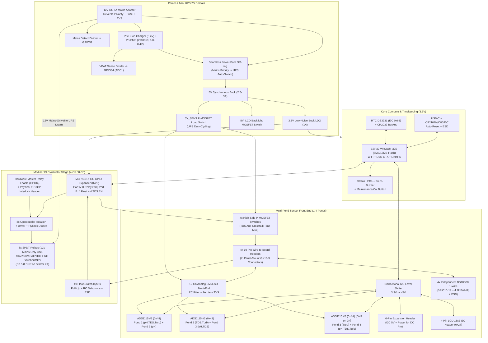

# Prompt Desain Custom PCB BanyuWening Core Hub v2 — CELUS Design Studio

Dokumen ini berisi spesifikasi teknis dan **prompt siap pakai (*copy-paste*)** untuk meminta **CELUS Design Studio (Design Assistant / CUBO Engine)** merancang custom PCB **BanyuWening Core Hub v2** (Custom Carrier PCB IoT Edge Mini-PLC untuk pemantauan kualitas air dan kontrol aktuator multi-kolam budidaya ikan lele).

Seluruh kebutuhan perangkat keras pada prompt ini diturunkan langsung dari dokumen kanonikal proyek:
- `brief/PRD_BanyuWening.md` (v2.1 — terutama Addendum Normatif §12)
- `brief/plan.md` (§2 Kontrak Data & §7 Re-baseline Implementasi v2.1)
- `brief/Materi_Pitch_Deck_BanyuWening (1).md` (Slide 3, 4, 7, 10 & Catatan Ronde 2)
- `laravel-app/app/Services/TelemetryIngestionService.php` (kontrak telemetri termasuk `battery_v`, `water_level`, `mode`, failsafe)

---

## 1. Panduan Penggunaan di CELUS Design Studio

1. **Mengapa isi prompt ditulis dalam Bahasa Inggris?**  
   Mesin *Design Assistant* dan pencocokan **CUBO™** di CELUS (`app.celus.io`) diindeks menggunakan terminologi komponen, antarmuka, dan *datasheet* berbahasa Inggris. Prompt berbahasa Inggris menghasilkan resolusi CUBO, pemetaan domain tegangan, dan *netlist* yang jauh lebih akurat.
2. **Pilih salah satu alur kerja:**
   - **Cara 1 — Master Prompt (Bagian 3):** Tempel satu prompt penuh sekaligus untuk menghasilkan rancangan blok diagram awal secara lengkap.
   - **Cara 2 — Prompt Bertahap 5 Langkah (Bagian 4 — Disarankan untuk PCB kompleks):** Bangun kanvas CELUS secara iteratif per subsistem (Power/MCU → Sensor/ADC → Relay/PLC → HMI/Ekspansi → Review) agar CELUS tidak melewatkan detail pin, alamat I2C, atau proteksi EMI.
   - **Cara 3 — Varian Split-Board (Bagian 5):** Gunakan jika ingin memisahkan papan utama tegangan rendah (≤12V DC) dari modul relay AC 220V untuk mempermudah sertifikasi keselamatan/SDPPI dan fleksibilitas paket Starter 2K vs Juragan 4K.
3. **Satu Desain PCB untuk Dua Varian Produk (Unified Carrier PCB):**
   - **Starter 2K (2 Kolam):** Populasi `2× ADS1115` (8 kanal ADC), `4× Relay`, `2× Header Sensor Kolam (GX16 aktif)` — sisanya ditandai **DNP (*Do Not Populate*)**.
   - **Juragan 4K (4 Kolam):** Populasi penuh `3× ADS1115` (12 kanal ADC), `8× Relay Optocoupler`, `4× Header Sensor Kolam (GX16 aktif)` + `1× Slot Ekspansi DO Pro`.
4. **Catatan Penyelarasan Spesifikasi sebelum Fabrikasi:**
   - **Mini UPS dikunci pada 2S Li-Ion (2×18650, nominal 7,4V / 6,0V–8,4V) + BMS** sesuai PRD §12.1–12.2 dan revisi Ronde 2 (bukan 3S), karena buck regulator 5V tetap efisien turun hingga 6,0V tanpa perlu *boost converter* berisik dan menjaga target biaya komponen.
   - **Kabel sensor analog *shielded*:** dirancang untuk panjang operasional klaster kolam **≤ 3–5 meter** (sesuai Pitch Deck & analisis EMI) dengan filter RC + ferrite bead + TVS di sisi PCB; pengujian lapangan wajib dilakukan bila jarak dinaikkan (merujuk catatan uji EMI di PRD §12.1).
   - **Isolasi beban AC 220V saat PLN padam:** Koil relay 12V disuplai **hanya dari adaptor PLN 12V** (bukan dari Mini UPS 2S), sehingga saat PLN padam seluruh relay otomatis nonaktif dan kapasitas baterai UPS 100% difokuskan untuk menjaga ESP32, RTC DS3231, logging LittleFS, dan pengiriman peringatan padam listrik selama target **6–12 jam**.

---

## 2. Arsitektur Referensi Teknis (Single Source of Truth)

### 2.1 Diagram Blok Sistem (Dapat juga diunggah ke fitur *Image-to-Design* CELUS)



### 2.2 Peta Alamat I2C (Terverifikasi Bebas Konflik)

| Perangkat | Domain Tegangan | Alamat I2C (7-bit) | Konfigurasi Pin ADDR | Peran |
| :--- | :---: | :---: | :--- | :--- |
| `MCP23017` | 3,3V | `0x20` | `A0=A1=A2=GND` (jumper opsional `0x20–0x27`) | 8 kontrol relay (`GPA0–7`), 4 input float (`GPB0–3`), 4 kontrol MOSFET TDS (`GPB4–7`) |
| `LCD 16x2 PCF8574` | 5,0V (via Level Shifter) | `0x27` / `0x3F` | Eksternal (header 4-pin) | Display lokal tepi kolam |
| `ADS1115 #1` | 5,0V (via Level Shifter) | `0x48` | `ADDR → GND` | Pond 1 (`pH, TDS, Turb`) + Pond 2 (`pH`) |
| `ADS1115 #2` | 5,0V (via Level Shifter) | `0x49` | `ADDR → VDD (5V)` | Pond 2 (`TDS, Turb`) + Pond 3 (`pH, TDS`) |
| `ADS1115 #3` | 5,0V (via Level Shifter) | `0x4A` | `ADDR → SDA` | Pond 3 (`Turb`) + Pond 4 (`pH, TDS, Turb`) *(DNP pada Starter 2K)* |
| `RTC DS3231` | 3,3V | `0x68` | Tetap | Timestamp akurat untuk LittleFS *store-and-forward* |
| `Slot DO Pro (Ekspansi)` | 5,0V (via Level Shifter) | Bebas (`0x4B`, `0x61`, dll.) | Header ekspansi 6-pin | Add-on modul sensor Dissolved Oxygen Pro / I2C masa depan |

### 2.3 Alokasi Pinout ESP32-WROOM-32E (Aman dari Strapping & Konflik WiFi/ADC2)

| Pin ESP32 | Arah | Fungsi | Catatan Keamanan Desain |
| :--- | :---: | :--- | :--- |
| `GPIO21` / `GPIO22` | I/O | `I2C_SDA_3V3` / `I2C_SCL_3V3` | Pull-up 4,7kΩ ke 3,3V; terhubung ke DS3231, MCP23017, dan Level Shifter |
| `GPIO16, 17, 18, 19` | I/O | `DS18B20_POND1..4` (1-Wire independen) | 1 GPIO per kolam agar penggantian probe *plug-and-play* tanpa pairing alamat ROM; pull-up 4,7kΩ + ESD |
| `GPIO23` | Out | `MCP23017_RST` | Reset perangkat keras untuk memastikan semua relay OFF saat boot/recovery |
| `GPIO4` | Out | `RELAY_MASTER_EN` | Pull-down 10kΩ; memutus jalur common LED optocoupler secara hardware saat MCU reset/crash |
| `GPIO25` | Out | `SENS_5V_EN` | Mengaktifkan/mematikan rail `5V_SENS` (P-MOSFET) untuk *duty-cycling* saat mode UPS |
| `GPIO26` | Out | `LCD_BL_EN` | Mengontrol *backlight* LCD 16x2 (OFF otomatis saat PLN padam) |
| `GPIO27` | Out | `BUZZER_CTRL` | Driver transistor/MOSFET untuk piezo buzzer alarm lokal |
| `GPIO32` / `GPIO33` | Out | `LED_WIFI_MQTT` / `LED_ALARM_FAULT` | Indikator status jaringan dan peringatan kritis |
| `GPIO13` | I/O | `EXP_GPIO_INT` | Pin interrupt/auxiliary untuk slot ekspansi DO Pro |
| `GPIO34` (ADC1_CH6) | In | `VBAT_ADC` | Pembagi tegangan dari baterai 2S (`≤8,4V → ≤2,7V`), aman digunakan saat WiFi aktif |
| `GPIO35` (Input-only) | In | `MAINT_BTN` | Tombol fisik Mode Maintenance/Kalibrasi (eksternal pull-up 10kΩ + debounce 100nF) |
| `GPIO36` (VP, Input-only) | In | `MCP23017_INTB` | Interrupt cepat dari 4 Float Switch (eksternal pull-up 10kΩ) |
| `GPIO39` (VN, Input-only) | In | `MAINS_DETECT` | Deteksi adaptor 12V PLN sebelum dioda OR-ing (pembagi tegangan + Zener/TVS 3,3V) |
| `GPIO1` / `GPIO3` | UART0 | `TX0` / `RX0` | USB-to-UART (`CP2102N`/`CH340C`) untuk flashing & debug |
| `GPIO0` / `EN` | Ctrl | Auto-reset + tombol `BOOT` & `RESET` | Rangkaian dual-transistor standar pemrograman ESP32 |
| `GPIO2, 5, 12, 15` | — | **Tidak dipakai untuk beban eksternal** | Menjaga pin strapping boot & tegangan flash (`MTDI/GPIO12`) tetap aman |

### 2.4 Pemetaan Pin Konektor Modul Sensor Kolam (4× Header 10-Pin → Panel-Mount GX16-9)

| Pin Header PCB | Pin GX16-9 | Nama Sinyal | Keterangan |
| :---: | :---: | :--- | :--- |
| 1 | Pin 1 | `5V_SENS` | Catu 5V terfilter & *switchable* untuk modul pH (`PH-4502C`) & Turbidity |
| 2 | Pin 2 | `TDS_VCC_SW_x` | Catu 5V/3,3V khusus TDS melalui High-Side P-MOSFET (mencegah korosi & *crosstalk* ke probe pH) |
| 3 | Pin 3 | `3V3_SENS` | Catu 3,3V untuk sensor suhu `DS18B20` |
| 4 | Pin 4 | `GND_SENS` | Ground referensi sensor analog/digital kolam |
| 5 | Pin 5 | `PH_AIN_x` | Sinyal analog pH (0–5V) → Filter RC + TVS → `ADS1115` |
| 6 | Pin 6 | `TDS_AIN_x` | Sinyal analog TDS (0–3,3V/5V) → Filter RC + TVS → `ADS1115` |
| 7 | Pin 7 | `TURB_AIN_x` | Sinyal analog Turbidity (0–4,5V) → Filter RC + TVS → `ADS1115` |
| 8 | Pin 8 | `DS18B20_DQ_x` | Data 1-Wire `DS18B20` → pull-up 4,7kΩ + ESD → `GPIO16–19` |
| 9 | Pin 9 | `FLOAT_IN_x` | Kontak kering *Float Switch* (return ke GND) → pull-up + debounce → `MCP23017 GPB0–3` |
| 10 | Shell/Body | `CABLE_SHIELD` | Terminasi *shield* kabel di sisi Core Hub saja (ke chassis/star-ground via RC/ferrite untuk cegah *ground loop*) |

---

## 3. MASTER PROMPT UNTUK CELUS (Copy-Paste Langsung)

Salin seluruh teks di dalam blok kode di bawah ini dan tempel ke **CELUS Design Assistant** untuk membuat rancangan PCB lengkap **BanyuWening Core Hub v2** dalam satu kali prompt:

```text
Design a custom industrial-grade IoT carrier PCB called "BanyuWening Core Hub v2" for a modular multi-pond smart aquaculture monitoring and mini-PLC actuator control system (freshwater catfish farming, IP65 outdoor enclosure, Indonesia tropical climate 20°C–45°C).

The single unified PCB must support up to 4 aquaculture ponds (with optional DNP / Do-Not-Populate sections to assemble a lower-cost 2-pond variant "Starter 2K" and a full 4-pond variant "Juragan 4K").

### 1. MICROCONTROLLER, CONNECTIVITY & STORAGE
- Main MCU: Espressif ESP32-WROOM-32E (8MB or 16MB SPI Flash variant for Dual-Partition OTA firmware updates and LittleFS local store-and-forward telemetry logging; Wi-Fi 2.4 GHz pre-certified module).
- USB-C Programming & Debug Interface: USB-C receptacle (with 5.1k CC resistors, ESD protection on D+/D-) connected to a USB-to-UART bridge (CP2102N or CH340C) with standard ESP32 auto-program dual-transistor circuit (EN and GPIO0), plus physical RESET and BOOT tactile pushbuttons.
- Real-Time Clock (RTC): High-accuracy I2C RTC DS3231 (fixed address 0x68) on the 3.3V domain with CR2032 coin-cell battery holder for accurate offline timestamps during Wi-Fi and mains outages.
- Keep ESP32 strapping pins (GPIO2, GPIO5, GPIO12, GPIO15) free of conflicting external loads; never use flash pins GPIO6–GPIO11.

### 2. POWER ARCHITECTURE & INTEGRATED MINI UPS (2S LI-ION)
- Primary Power Input: 12V DC (3A–5A) via both a 2-pin 5.08mm screw terminal block and DC barrel jack, protected by an input fuse (5A), reverse-polarity protection (P-MOSFET or Schottky diode), and SMBJ15A TVS surge suppressor.
- Integrated Mini UPS (2S Li-Ion, 7.4V nominal / 6.0V–8.4V range):
  - 2-cell 18650 battery pack interface (2-pin JST-XH/screw terminal + optional onboard dual 18650 holder footprint) with integrated 2S Li-Ion CC/CV battery charger IC (8.4V charge voltage, ~1A charge current, powered from 12V mains input) and 2S BMS protection circuit (overcharge, over-discharge cutoff ~6.0V, overcurrent, short-circuit, and cell balancing).
  - Seamless power-path OR-ing circuit (ideal diode / P-MOSFET + Schottky auto-switchover) between 12V Mains and 2S Battery so the MCU never resets during power loss (zero-brownout switchover).
- Voltage Regulators (High Efficiency for 6–12 Hour UPS Target):
  - Main 5V Rail (5V_SYS): High-efficiency synchronous buck converter (input 6.0V–16V, output 5.0V at 2.5A–3A) fed from the OR-ing rail.
  - Main 3.3V Rail (3V3_SYS): High-efficiency 3.3V buck regulator or low-Iq low-noise LDO (output 3.3V at >=1A continuous, with generous bulk capacitance >=47uF low-ESR) to reliably handle ESP32 Wi-Fi TX current bursts without brownout.
  - Switched Analog Sensor 5V Rail (5V_SENS): High-side P-MOSFET load switch controlled by ESP32 GPIO25 + LC pi-filter to power analog water sensors and allow power-gating / duty-cycling during UPS battery operation.
  - Switched LCD Backlight Rail (5V_LCD_BL): MOSFET switch controlled by ESP32 GPIO26 so firmware turns off the 16x2 LCD backlight during mains outages.
- Power Telemetry & Outage Detection:
  - Mains Presence Detector (MAINS_DETECT): Voltage divider tapped directly from the 12V input BEFORE the OR-ing diode (clamped with 3.3V Zener/TVS) wired to ESP32 GPIO39 (input-only) so firmware immediately differentiates PLN mains outage from Wi-Fi loss.
  - Battery Voltage Monitor (VBAT_ADC): High-impedance voltage divider from 2S battery pack (8.4V max scaled to <=2.7V, with 100nF filter cap) wired to ESP32 GPIO34 (ADC1_CH6, Wi-Fi safe).
- CRITICAL SAFETY POWER SEPARATION: The 12V Relay Coil power rail (12V_RELAY) must be powered EXCLUSIVELY from the 12V Mains Adapter rail (never from the 2S Mini UPS battery), so AC actuators automatically de-energize on mains loss and never drain the UPS battery.

### 3. MULTI-POND SENSOR ACQUISITION (4 PONDS, 12 ANALOG + 8 DIGITAL CHANNELS)
- Bidirectional I2C Logic Level Shifter (3.3V <-> 5V): Bridges ESP32 I2C bus (GPIO21 SDA, GPIO22 SCL, 4.7k pull-ups on 3.3V side) to a 5V I2C bus (4.7k pull-ups on 5V side) for 5V ADCs, 16x2 LCD, and expansion port.
- External 16-Bit Precision ADCs (3x TI ADS1115 on 5V I2C Bus = 12 Single-Ended Channels):
  - ADS1115 #1 (I2C address 0x48, ADDR=GND): Pond 1 pH, Pond 1 TDS, Pond 1 Turbidity, Pond 2 pH.
  - ADS1115 #2 (I2C address 0x49, ADDR=VDD): Pond 2 TDS, Pond 2 Turbidity, Pond 3 pH, Pond 3 TDS.
  - ADS1115 #3 (I2C address 0x4A, ADDR=SDA, mark as DNP option for 2-pond variant): Pond 3 Turbidity, Pond 4 pH, Pond 4 TDS, Pond 4 Turbidity.
  - Analog Front-End Protection on all 12 analog channels: Each input receives an RC low-pass anti-aliasing/EMI filter (1k ohm series resistor + 100nF capacitor), ferrite bead on connector entry, and 5V ESD/TVS clamping diode protection to withstand 3–5 meter shielded pond cables near AC pumps.
- Anti-Crosstalk TDS Sensor Power Switching (4 Channels):
  - 4 independent high-side P-MOSFET load switches (one per pond, e.g., AO3401A / IRLML6402 with gate pull-ups and NPN/logic level drive) controlled by MCP23017 pins GPB4–GPB7. These time-multiplex power to each analog TDS probe strictly during measurement to eliminate galvanic ground-loop crosstalk with the glass pH probe in the same pond and prevent electrode electrolysis.
- Waterproof Temperature Sensors (4x DS18B20 1-Wire):
  - 4 independent 1-Wire digital channels connected to ESP32 GPIO16, GPIO17, GPIO18, and GPIO19 (one dedicated GPIO per pond for plug-and-play probe replacement without ROM pairing), each with a 4.7k ohm pull-up to 3.3V, series 100 ohm damping resistor, and 3.3V ESD diode.
- Water Level Float Switches (4 Channels):
  - 4 dry-contact digital inputs connected to MCP23017 pins GPB0–GPB3, each with a 10k ohm pull-up to 3.3V, RC hardware debounce filter (1k ohm + 100nF), and ESD protection. Connect MCP23017 INTB pin to ESP32 GPIO36 (with external 10k pull-up) for immediate low-water safety interlock interrupts.
- Pond Connector Interface:
  - 4x keyed 10-pin wire-to-board headers (JST-XH or 3.81mm pluggable terminal blocks, labeled POND_1 through POND_4; POND_3 and POND_4 marked optional DNP for 2-pond variant) to harness internally to 4 panel-mount waterproof GX16-9 chassis connectors on the IP65 enclosure.
  - Pinout per pond header: [1: 5V_SENS, 2: TDS_VCC_SW, 3: 3V3_SENS, 4: GND_SENS, 5: PH_AIN, 6: TDS_AIN, 7: TURB_AIN, 8: DS18B20_DQ, 9: FLOAT_IN, 10: CABLE_SHIELD (tied to chassis/star ground via RC/ferrite)].

### 4. MODULAR MINI-PLC ACTUATOR STAGE (8-CHANNEL OPTO-ISOLATED RELAYS)
- I2C GPIO Expander: Microchip MCP23017 (16-bit I2C GPIO expander on 3.3V bus, default I2C address 0x20 via A0/A1/A2 solder jumpers to GND, RESET pin controlled by ESP32 GPIO23).
  - Port A (GPA0–GPA7): Drives Relay Channels 1 to 8 (Ch 1–4 populated on Starter 2K; Ch 5–8 marked DNP option for Juragan 4K).
  - Port B (GPB0–GPB3): 4x Float Switch inputs; (GPB4–GPB7): 4x TDS MOSFET power switches.
- Galvanic Isolation & Fail-Safe Relay Driver Stage:
  - Hardware Master Relay Enable (ESP32 GPIO4 with 10k pull-down) gates the optocoupler LED common rail so all relays are hardware-forced OFF during boot, reset, or MCU lockup.
  - Physical Emergency Stop (E-STOP) 2-pin header in series with the 12V_RELAY coil supply (normally closed jumper or external emergency kill pushbutton) to cut all 8 actuators immediately regardless of firmware.
  - 8x Optocouplers (e.g., PC817 / EL817 or 2x quad LTV-847/TLP293-4) providing full galvanic isolation between 3.3V logic ground and 12V relay coil ground.
  - Relay coil driver (ULN2803A Darlington array or 8x discrete N-MOSFET/NPN drivers) with mandatory flyback clamping diodes (1N4007 / integrated clamp) across every 12V relay coil and individual status LEDs per channel.
  - 8x SPDT Power Relays (12V DC coil, contacts rated 10A 250V AC / 30V DC, e.g., Omron G5LE-1 or Songle SRD-12VDC-SL-C equivalent) routed to 8x 3-pin 5.08mm high-current screw terminal blocks (COM, NO, NC) for AC 220V aerators and pumps or 12V DC dosing pumps.
  - Inductive Load Surge Suppression: Include RC snubber / MOV varistor footprints across each relay COM–NO contact to suppress back-EMF arcs from inductive aerator and pump motors.

### 5. LOCAL HMI & EXPANSION SLOT
- 16x2 I2C LCD Display Header: 4-pin JST-XH / 2.54mm header (5V_LCD, GND, SDA_5V, SCL_5V; address 0x27/0x3F) with switched backlight rail.
- Local Audible Alarm: Piezo buzzer driven via NPN transistor/N-MOSFET from ESP32 GPIO27 for critical water alerts and PLN blackout alarms.
- Status LEDs: 12V Mains Present (Green), UPS Battery Mode (Amber), Wi-Fi/MQTT Online on GPIO32 (Blue), Critical Fault/Alarm on GPIO33 (Red).
- Maintenance / Calibration Mode Button: Tactile switch on ESP32 GPIO35 (external 10k pull-up + 100nF debounce) to pause ML telemetry ingestion during weekly probe rinsing and 2-point pH calibration.
- Expansion Slot (DO Pro Add-On): 1x 6-pin wire-to-board header (5V_EXP via PTC fuse, 3V3_EXP, GND, SDA_5V, SCL_5V, EXP_GPIO_INT on GPIO13) with ESD protection for a future 5th GX16 port supporting an industrial Dissolved Oxygen (DO Pro) I2C module.

### 6. PCB DESIGN, EMC, SAFETY & EXPORT CONSTRAINTS
- Verify zero I2C address conflicts across all blocks: MCP23017 (0x20), LCD (0x27/0x3F), ADS1115 #1 (0x48), ADS1115 #2 (0x49), ADS1115 #3 (0x4A), DS3231 (0x68).
- Recommend a 4-layer PCB stackup (Signal/Power – Solid GND – Power – Signal) with clear physical separation between: (a) RF antenna keep-out zone at the board edge for ESP32-WROOM, (b) Low-noise analog sensor front-end & ADS1115 zone, (c) Digital/UPS power zone, and (d) High-voltage 220V AC relay contact zone with >=6.4mm creepage/clearance and isolation slots.
- Include 4x M3 mounting holes for IP65 enclosure mounting and labeled test points (12V_IN, VBAT, 5V_SYS, 3V3_SYS, 5V_SENS, I2C_SDA, I2C_SCL, GND) for 48-hour factory burn-in QC testing.
- Generate the complete functional block diagram, resolve reliable in-stock CUBOs, verify voltage/interface compatibility, produce a full BOM with Starter 2K DNP annotations, and prepare schematic/layout files suitable for KiCad / Altium export.
```

---

## 4. PROMPT BERTAHAP CELUS (Iterative Canvas Workflow — 5 Langkah)

Jika hasil satu prompt penuh terlalu padat atau beberapa blok belum ter-resolve ke CUBO secara presisi di CELUS Design Assistant, gunakan **urutan 5 prompt iteratif** berikut di satu kanvas yang sama:

### Langkah 1 — Fondasi: MCU, Daya 12V, Mini UPS 2S, dan RTC
```text
Create a new functional block diagram for "BanyuWening Core Hub v2", an industrial IoT smart aquaculture controller PCB. Start with the core compute and power subsystems:

1. MCU: ESP32-WROOM-32E (8MB or 16MB flash) with USB-C port (5.1k CC resistors, ESD protection), CP2102N or CH340C USB-to-UART auto-program circuit, and physical RESET and BOOT buttons.
2. RTC: I2C DS3231 real-time clock (address 0x68) on 3.3V with CR2032 backup battery holder.
3. Primary Power: 12V DC (5A) input via screw terminal and barrel jack with 5A fuse, reverse polarity protection, and SMBJ15A TVS surge protection.
4. Integrated Mini UPS (2S Li-Ion 2x18650, 7.4V nominal, 6.0V–8.4V): 2S Li-Ion CC/CV battery charger (8.4V) powered by 12V input, 2S BMS protection circuit, and seamless power-path OR-ing switchover between 12V mains and 2S battery.
5. Regulators from the OR-ing rail:
   - High-efficiency 5V synchronous buck converter (2.5A–3A).
   - 3.3V regulator (>=1A low-noise buck or low-Iq LDO) with adequate decoupling for ESP32 Wi-Fi TX bursts.
   - High-side P-MOSFET load switch on 5V (controlled by GPIO25) creating a switchable LC-filtered 5V_SENS rail for UPS power-saving duty-cycling.
6. Power Monitoring:
   - Mains presence voltage divider from 12V input BEFORE the OR-ing diode (3.3V clamped) to ESP32 GPIO39.
   - 2S battery voltage divider (8.4V scaled to <=2.7V) to ESP32 GPIO34 (ADC1).
Keep a separate 12V_RELAY rail tapped directly from the 12V mains input (NOT backed by the UPS).
```

### Langkah 2 — Subsistem Akuisisi Sensor Multi-Kolam (3× ADS1115 + Level Shifter + EMI + TDS MOSFET)
```text
Now add the multi-pond water quality sensor acquisition subsystem (supporting 4 ponds total, 12 analog channels + 4 digital temperature channels) to the current design:

1. Add a bidirectional 3.3V <-> 5V I2C logic level shifter connected to ESP32 GPIO21 (SDA) and GPIO22 (SCL) with 4.7k pull-ups on both voltage domains.
2. Add three TI ADS1115 16-bit 4-channel I2C ADCs on the 5V I2C bus with unique hardwired addresses:
   - ADS1115 #1 at 0x48 (ADDR=GND): Pond 1 pH, TDS, Turbidity + Pond 2 pH.
   - ADS1115 #2 at 0x49 (ADDR=VDD): Pond 2 TDS, Turbidity + Pond 3 pH, TDS.
   - ADS1115 #3 at 0x4A (ADDR=SDA, optional DNP for 2-pond variant): Pond 3 Turbidity + Pond 4 pH, TDS, Turbidity.
3. Add analog EMI/ESD protection on all 12 ADC input channels: ferrite bead, 1k ohm + 100nF RC low-pass filter, and 5V TVS/ESD clamping diodes for 3–5 meter shielded cables.
4. Add 4 independent high-side P-MOSFET load switches (fed from 5V_SENS) to power-switch the 4 pond TDS sensors independently (preventing galvanic ground-loop crosstalk with pH glass probes and electrode corrosion).
5. Add 4 independent 1-Wire digital channels for DS18B20 temperature probes connected directly to ESP32 GPIO16, GPIO17, GPIO18, and GPIO19 (each with 4.7k pull-up to 3.3V and 3.3V ESD diode).
6. Add four 10-pin wire-to-board headers (POND_1 to POND_4, wiring internally to IP65 panel-mount GX16-9 connectors) carrying: 5V_SENS, TDS_VCC_SW, 3V3_SENS, GND_SENS, PH_AIN, TDS_AIN, TURB_AIN, DS18B20_DQ, FLOAT_IN, and CABLE_SHIELD.
```

### Langkah 3 — Subsistem Mini-PLC Aktuator (MCP23017 + 8-Channel Opto-Relay + Interlock Safety)
```text
Now add the modular Mini-PLC actuator control and water-level interlock subsystem:

1. Add a Microchip MCP23017 16-bit I2C GPIO expander on the 3.3V I2C bus at address 0x20 (A0/A1/A2 tied to GND via solder jumpers, RESET pin on ESP32 GPIO23, INTB pin on ESP32 GPIO36 with external 10k pull-up).
2. Connect MCP23017 Port B:
   - GPB0–GPB3 as inputs for the 4 Pond Float Switches (10k pull-up to 3.3V, 1k + 100nF RC debounce, ESD protection).
   - GPB4–GPB7 as outputs driving the 4 TDS sensor high-side MOSFET power switches added in the previous step.
3. Connect MCP23017 Port A (GPA0–GPA7) to an 8-channel optocoupler-isolated relay driver stage:
   - Add a hardware Master Relay Enable switch controlled by ESP32 GPIO4 (with 10k pull-down) gating the optocoupler LED common rail so relays remain hardware-OFF during MCU boot/reset.
   - Use 8x optocouplers (PC817/EL817 or quad LTV-847) isolating 3.3V MCU ground from 12V relay coil ground.
   - Drive 8x 12V SPDT relays (10A 250VAC / 30VDC) via ULN2803A or discrete transistors with flyback diodes and per-channel indicator LEDs. Mark Relay Channels 5–8 as DNP options for the 2-pond Starter variant.
   - Power all relay coils strictly from the 12V_RELAY mains-only rail, routed through a 2-pin physical Emergency Stop (E-STOP) interlock header.
   - Route each relay COM, NO, and NC contact to 5.08mm high-current screw terminal blocks, including RC snubber / MOV varistor footprints across COM–NO for inductive AC aerator and pump loads.
```

### Langkah 4 — HMI Lokal, Indikator, Tombol Maintenance & Slot Ekspansi DO Pro
```text
Now add the local HMI and expansion interfaces:

1. Add a 4-pin header for an external 16x2 I2C LCD display (5V I2C bus, address 0x27/0x3F) with a MOSFET switch controlled by ESP32 GPIO26 to cut LCD backlight power during UPS battery mode.
2. Add a local piezo alarm buzzer driven via an NPN transistor/N-MOSFET from ESP32 GPIO27.
3. Add 4 status LEDs: Mains 12V OK (Green), UPS Active (Amber), Wi-Fi/MQTT Status on GPIO32 (Blue), and Fault/Alarm on GPIO33 (Red).
4. Add a Maintenance/Calibration tactile pushbutton on ESP32 GPIO35 (external 10k pull-up + 100nF debounce capacitor).
5. Add a 6-pin expansion header (for a future 5th GX16 port / Dissolved Oxygen DO Pro sensor add-on) carrying: 5V_EXP (PTC-fused), 3V3_EXP, GND, SDA_5V, SCL_5V, and ESP32 GPIO13, protected with ESD diodes.
6. Add 4x M3 mounting holes and labeled test points (12V_IN, VBAT, 5V_SYS, 3V3_SYS, 5V_SENS, I2C_SDA, I2C_SCL, GND) for 48-hour QC burn-in testing.
```

### Langkah 5 — Audit Otomatis, Verifikasi CUBO & Persiapan Export EDA
```text
Please review the complete BanyuWening Core Hub v2 block diagram and CUBO resolution before EDA export:
1. Verify all I2C addresses have zero conflicts (MCP23017=0x20, LCD=0x27/0x3F, ADS1115=0x48/0x49/0x4A, DS3231=0x68) and confirm pull-up resistors exist on both 3.3V and 5V sides of the level shifter.
2. Verify that ESP32 strapping pins (GPIO0, GPIO2, GPIO5, GPIO12, GPIO15) have no boot-blocking loads, input-only pins (GPIO34–39) are used strictly as inputs with external pull-ups where needed, and ADC1 (GPIO34) is used for battery sensing so Wi-Fi does not interfere.
3. Verify the 12V_RELAY coil rail is completely isolated from the 2S Mini UPS battery path so relays turn OFF immediately on mains loss, and confirm galvanic isolation across the optocouplers.
4. Check power budget in normal mains mode vs UPS battery-saving mode (5V_SENS duty-cycled, LCD backlight OFF, relays OFF) to support 6–12 hour logging runtime on a 2S 18650 pack.
5. Flag any obsolete or low-stock components in the resolved CUBOs, mark Starter 2K DNP blocks (ADS1115 #3, POND_3/4 headers, Relay Ch 5–8), and prepare clean schematic, BOM, and PCB floorplan export for KiCad / Altium Designer.
```

---

## 5. PROMPT VARIAN OPSIONAL: Arsitektur Split-Board (Mainboard DC ≤12V + Relay Board AC 220V Terpisah)

Jika Anda ingin **papan utama Core Hub v2 bebas dari tegangan tinggi AC 220V** (lebih aman untuk teknisi, mengurangi noise EMI AC di dekat sensor pH/ADS1115, dan mempermudah pemilihan modul relay 4-Ch untuk Starter 2K vs 8-Ch untuk Juragan 4K), berikan prompt revisi berikut di CELUS setelah Langkah 1–4:

```text
Modify the actuator stage to use a split-board architecture for better high-voltage safety and EMI isolation:
- Remove the 8 onboard 220V AC power relays and 5.08mm AC terminal blocks from the main Core Hub v2 PCB so this main carrier PCB stays strictly Low-Voltage DC (<=12V).
- Keep the MCP23017 (0x20), Hardware Master Relay Enable (GPIO4), E-STOP interlock header, and per-channel status LEDs on the mainboard.
- Replace the onboard relays with a shrouded 12-pin keyed wire-to-board header (or pluggable terminal block) carrying 8 buffered relay control signals (CH1–CH8, with ESD/series resistors), 12V_RELAY_MAINS_ONLY, 5V_RELAY_LOGIC, and GND to connect to an external optocoupler-isolated 4-Channel (Starter 2K) or 8-Channel (Juragan 4K) AC 220V relay module mounted in a separate compartment of the IP65 panel box.
```

---

## 6. Checklist Verifikasi Wajib Pasca-Export CELUS (Di KiCad / Altium Sebelum Order PCB)

CELUS sangat kuat pada tahap **Block Diagram → Resolusi CUBO → Skematik → BOM → Floorplan awal**, tetapi sebelum file Gerber dikirim ke pabrik PCB (JLCPCB / PCBWay / lokal), lakukan verifikasi manual berikut di KiCad atau Altium:

- [ ] **Antenna Keep-Out Zone ESP32-WROOM:** Pastikan antena PCB `ESP32-WROOM-32E` berada di tepi board tanpa bidang tembaga (*copper pour*), ground plane, atau komponen logam di bawah maupun di samping antena (minimal 15 mm ruang bebas) untuk menjaga performa Wi-Fi dan lolos uji RF **SDPPI/DJID Komdigi**.
- [ ] **Isolasi Tegangan Tinggi AC 220V (jika relay on-board):** Pastikan jarak *creepage & clearance* minimal **≥ 6,4 mm** antara sisi koil/logika dan sisi kontak 220V AC, tambahkan *milled isolation slots* (celah potong PCB) antar jalur fase/netral dan antara koil–kontak, serta lebar trace jalur AC 10A minimal **2,5–3,0 mm** (lebih baik ketebalan tembaga **2 oz**).
- [ ] **Partisi Ground & EMI Analog:** Pisahkan zona analog sensitif (`ADS1115 #1–#3` + filter RC pH/TDS/Turbidity) sejauh mungkin dari switching inductor buck converter 5V dan jalur relay AC; tempatkan kapasitor decoupling (100nF + 10µF) sedekat mungkin ke pin `VDD` setiap `ADS1115`, `ESP32`, dan `MCP23017`.
- [ ] **Konfirmasi Strapping Alamat I2C ADS1115:** Periksa skematik pin `ADDR` fisik ketiga IC: `#1 → GND (0x48)`, `#2 → VDD 5V (0x49)`, `#3 → SDA_5V (0x4A)`. Pastikan tidak ada tabrakan dengan `MCP23017 (0x20)`, `LCD (0x27/0x3F)`, dan `DS3231 (0x68)`.
- [ ] **Verifikasi Jalur Daya Mini UPS 2S:** Pastikan pembagi tegangan `MAINS_DETECT` disadap **sebelum** dioda OR-ing (bukan sesudah), koil relay 12V tidak terhubung ke keluaran baterai 2S, dan buck 5V tetap stabil sampai tegangan baterai turun ke ~6,0V (batas cut-off BMS 2S).
- [ ] **Verifikasi Mekanikal Box IP65 & Silkscreen QC:** Sesuaikan ukuran PCB dan posisi 4 lubang baut M3 dengan *enclosure* IP65 yang dibeli; tambahkan label silkscreen jelas pada setiap header (`POND 1–4`, `RELAY 1–8`, `E-STOP`, `12V IN`, `2S BATT`, `DO PRO EXP`, `MAINT BTN`) serta *test point* untuk jig **QC Burn-in Test 48 jam**.
